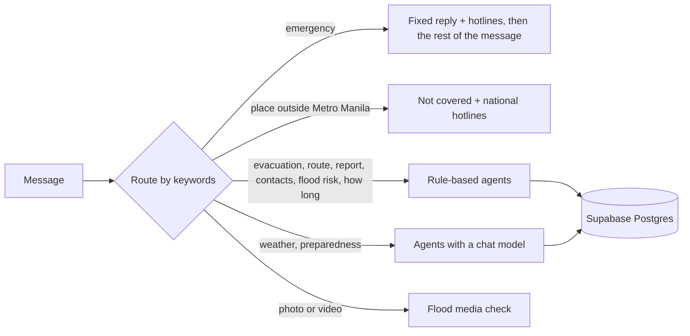

<p align="center">
  
</p>

<h1 align="center" id="title">
  
</h1>

A flood assistant for Metro Manila (NCR). Residents ask questions in English or Filipino and get answers
grounded in official sources: the nearest safe evacuation center, the flood risk for their area, a route that
avoids flooded streets, hotlines, and weather from PAGASA and Open-Meteo.

When the data is missing or unreliable, it says so and gives a fixed safety answer. It does not guess.

> **Status: early.** The agents, chat graph, retrieval, voice, flood-photo checks and the HTTP API are built and tested.
> The Next.js frontend is not built yet; a Streamlit dashboard is included as a sample.
> Before saving reports, run the table scripts once (see [Create the missing tables](#create-the-missing-tables)).
> See [docs/backend_architecture.md](docs/backend_architecture.md).

## Why this matters

The Philippines has topped the [World Risk Index](https://abs-cbn.com/news/2024/9/12/philippines-is-world-s-riskiest-country-for-3rd-straight-year-1758)
for several years running, including the [latest 2026 report](https://tribune.net.ph/2026/09/24/philippines-again-tops-global-disaster-risk-ranking).
[PAGASA](https://www.pagasa.dost.gov.ph/climate/tropical-cyclone-information) counts about 20 tropical cyclones
entering the Philippine Area of Responsibility each year, and 8 or 9 of them cross the country, mostly from July to October.

Metro Manila is where this risk is most concentrated: a dense, low-lying city of millions beside Manila Bay and several
rivers. In 2009, Typhoon Ondoy (Ketsana) dropped about 455 mm of rain in 24 hours on Quezon City
([see the account](https://www.gmanetwork.com/news/topstories/nation/709435/looking-back-at-ondoy-s-onslaught-10-years-later/story/))
and flooded a large part of the metropolis. Heavy rain from storms is expected to become more intense as the climate warms,
and sea levels are rising, so the flood risk for a city like this is likely to grow, not shrink.

### Why AI assistance helps

During a flood the problem is rarely a lack of information. It is that the information is scattered, long, and hard
to use under stress: PAGASA bulletins, NDRRMC manuals, evacuation lists and hotlines sit on different sites and in
different formats. An assistant can:

- **Find the right answer fast.** It reads the bulletins and documents for the person and answers in a few lines, in English or Filipino.
- **Use their location.** It combines where they are with live rain, river flow, tide and the evacuation-center list, instead of giving generic advice.
- **Be there at any hour and for many people at once,** when hotlines are busy and officials are stretched.
- **Understand how people really write and speak.** Messages are short, mixed Tagalog and English, and urgent. Voice and flood photos are supported too.
- **Take routine questions off responders,** so their time goes to rescue and coordination.
- **Turn community reports into something usable,** such as a flooded street that routes then avoid.

AI does not stop a flood, and it is not an official warning system. Here it is a way to put official information in
front of people sooner and in plain words. That is why the design is cautious: most answers come from fixed rules
and verified sources, emergencies get a fixed 911 reply, and when the data is missing it says so instead of guessing.
A person, such as a barangay or DRRMO, makes the real decisions.

### Who it is for

| Who | How it helps | Status |
|---|---|---|
| A resident in a flooded area | Nearest safe evacuation center, hotlines, safety steps, and a route that avoids floodwater | Built (API and agents) |
| A family preparing before a storm | Flood risk for their area, forecasts, and checklists from the preparedness manuals | Built (API and agents) |
| A neighbour who sees a flooded street | Report it, so routes avoid it | Built; needs the `reports` table to be created |
| Someone with a photo or video of flooding | Checks for flood water and gives a rough depth | Built (API and agents) |
| Barangay and DRRMO staff | A live list of reports and supply requests, with verify, reject and assign | API built (`/staff`, shared key); no staff screen yet |
| Relief volunteers | Matching needs with available supplies and centers | Planned |

## What you can ask

Ask in English, Filipino or a mix. Name a place (a city, a barangay, a subdivision, or share your pin) and the answer
is built for it. These are real prompts the agents answer today.

### Find safety and shelter

| Ask | You get |
|---|---|
| `Where is the nearest evacuation center to Brgy. Nangka, Marikina?` | The 3 nearest centers that are not in a flooded area, with distance, direction and capacity |
| `Saan ang pinakamalapit na evacuation center sa Marikina?` | It asks once for your barangay, subdivision or pin so the distances are exact; reply with `Brgy. Nangka, Marikina` to get the list |
| `Hotline ng Pasig?` | National numbers plus your city's rescue and fire lines, copied exactly from the contacts file |

### Know what is coming

| Ask | You get |
|---|---|
| `Babaha ba sa Marikina ngayong gabi?` | A risk level (low, watch, high, critical) with the reasons: rain, river flow, soaked ground, PAGASA warnings |
| `How long will the flood last in Marikina?` | A plain statement that nobody can predict it, plus the next 24 hours of rain and any high tide |
| `Uulan ba bukas sa Quezon City?` | PAGASA bulletins and the Open-Meteo forecast, in a short answer |
| `Mag forecast ka ng 7 days` | A 7-day outlook |

### Prepare and understand the rules

| Ask | You get |
|---|---|
| `Ano ang dapat ihanda bago bumaha?` | Steps and checklists from the preparedness manual, with the sources listed under the answer |
| `What is the process of relief goods?` | What the documents say, which documents they came from, and what they do not cover |

### Report and share

| Ask | You get |
|---|---|
| `I want to report a flooded street in Brgy. Nangka, Marikina` | Saved as an unverified community report; routes avoid the spot for a few hours (once the `reports` table exists) |

### In an emergency

`Water is up to my waist`, `Hanggang hita na ang baha`, `Trapped kami sa bubong`, `Tulong, nalulunod kami`.
The reply starts with the **911** text and local hotlines, with no model and no waiting. If the same message also asks
for something, it is answered right after:

> `Nasa Divisoria, Manila ako. Gusto kong mag-report ng baha hanggang baywang. Saan ako pwedeng pumunta na evacuation center at gaano katagal ang baha?`
>
> 911 and the Manila hotlines, then the report, the 3 nearest centers, and the "how long" answer, each under its own heading.

If no place is given, it asks for one right after the safety steps, and your next message (just `Marikina`) finishes the answer.

### Several questions in one message

`Mag forecast ka ng 7 days at kung bumaha hanggang tuhod, ano ang gagawin ko at saan ang evacuation center?` is cut into
a forecast, a preparedness answer and an evacuation-center question, each under its own heading. The forecast and the
preparedness answer come at once; if it does not know where you are, it asks, and your next message (`Brgy. Nangka, Marikina`)
finishes the centers.

### Outside Metro Manila

`Nasa Tanza, Cavite ako. May data ka ba ng baha?` gets a clear "not covered" reply with the national hotlines and
what to do, instead of a guess.

Most answers use fixed rules and no model, so they are fast, free per question, and the same every time.
Only weather, preparedness and photo or video questions use a chat model.

## How an answer is chosen

Messages are routed by keywords (no model call), and an emergency always wins. A message with several requests
("report the flood, where is the nearest center, and how long will it last?") is cut into one question per topic, and
each topic is answered under its own heading.



**Where the data comes from, in order of trust:**

1. PAGASA bulletin. It counts as unreliable when it is empty, very short, a block page, or says it was issued more than 24 hours ago.
2. Backup sources, each read on its own: tide height, ground height, and the official sites (NDRRMC, Red Cross, DSWD).
3. A fixed safety answer, when too few readings are left to say anything responsible.

Locations are read from GPS coordinates, "Brgy. Name, City", or a place next to a city ("Okada, Parañaque").
If only the city is known, the answer says distances are from the city centre. A place that is a known barangay
(from the evacuation-center list) is saved as a barangay. A place outside Metro Manila (Cavite, Rizal, Bulacan, and so on)
gets the "not covered" reply.

## Repository layout

```
backend/                 Python app (uv project)
  agents/                one module per agent: evacuation, flood risk, route, report, weather, location, ...
  langgraph_orchestrator/ chat graph, keyword routing, start-up
  src/api/               the HTTP API: app, routers, request models, rate limits
  src/rag/               document ingestion and retrieval (vector + keyword search, reranking)
  voice/  video/         speech-to-text WebSocket; flood photo and video checks
  sql/                   table scripts to run once in Supabase
  tests/                 unit tests (no network, browser or model needed)
corpus/                  source documents and CSVs (evacuation centers, hotlines, locations)
datasets/                daily NCR weather and flood-feature CSVs
scripts/                 data loading and the daily dataset update
docs/                    architecture, evaluation and deployment notes
frontend/                Next.js app (not built yet)
frontend_streamlit/      sample Streamlit dashboard
.github/workflows/       scheduled dataset update
```

## Getting started

Requires Python 3.11+ and [uv](https://docs.astral.sh/uv/).

```bash
cd backend
uv sync                  # heavy: includes torch and faiss-gpu
```

Create `backend/.env` (it is gitignored; never commit it) with these variables:

| Variable | Used for |
|---|---|
| `MUSE_API` | The chat model, speech-to-text and the flood photo and video check |
| `SUPABASE_PROJECT_REF`, `SUPABASE_PASSWORD`, `SUPABASE_POOLER_HOST` | Database connection |
| `LANGSMITH_KEY`, `LANGSMITH_TRACE`, `LANGSMITH_PROJECT` | Optional tracing |
| `HF_TOKEN` | Embedding model download in `scripts/ingest_corpus.py` |

Other keys that appear in the docs ([deployment guide](docs/deployment_workflow_guide.md)) are only needed for features
that are not wired up yet: `SUPABASE_PUBLISHABLE_KEY`, `SUPABASE_SECRET_KEY`, `SUPABASE_ACCESS_TOKEN`,
`GROQ_API_KEY` and `LLAMAINDEX_API_KEY`.

### Run the tests

```bash
cd backend
uv run python -m unittest discover -s tests -v
```

### Try the dashboard

```bash
pip install -r frontend_streamlit/requirements.txt
streamlit run frontend_streamlit/app.py
```

### Run the API

```bash
cd backend
uv run uvicorn main:app --reload        # then open http://127.0.0.1:8000/docs
```

For local work without the Postgres conversation store, add `CHECKPOINTER=memory` (conversations are then lost on restart).

| Method | Path | Purpose |
|---|---|---|
| POST | `/chat` | One message in, one reply out. Send back the returned `thread_id` to continue the conversation. `blocked` is true when the message was stopped by the input guard |
| POST, GET | `/reports` | Submit or list community flood reports (unverified) |
| POST | `/requests` | Submit a supply or assistance request (write only) |
| GET, PATCH | `/staff/...` | Staff only: summary counts, the full lists, and verifying, rejecting or assigning items. Needs `STAFF_API_KEY` |
| GET | `/evacuation-centers` | Search the centers by city and barangay |
| GET | `/advisories/latest` | Current PAGASA bulletins |
| GET | `/health`, `/health/ready` | What works right now |
| WS | `/ws/voice`, `/ws/camera` | Live speech-to-text and the webcam flood check |

```bash
curl -s localhost:8000/chat -H 'Content-Type: application/json' \
  -d '{"message": "Nasa Divisoria, Manila ako. Baha hanggang tuhod. Saan ang pinakamalapit na evacuation center?"}'
```

Optional settings (environment variables): `CORS_ORIGINS`, `CHECKPOINTER` (`postgres` or `memory`), `ENABLE_RAG`,
`TRUST_PROXY_HEADERS`, `CHAT_PER_MINUTE`, `REPORTS_PER_HOUR`, `REQUESTS_PER_HOUR`, `ORS_API_KEY`, `STAFF_API_KEY`, `STAFF_PER_MINUTE`.

### Monitor reports and requests (staff)

Set a long random `STAFF_API_KEY` in `backend/.env` to switch on the `/staff` endpoints. Without it they do not exist.
Generate one with `python -c "import secrets; print(secrets.token_urlsafe(32))"`, keep it private, and send it as a bearer token:

```bash
curl -s localhost:8000/staff/summary -H "Authorization: Bearer $STAFF_API_KEY"                  # what is waiting
curl -s 'localhost:8000/staff/requests?status=unverified' -H "Authorization: Bearer $STAFF_API_KEY"
curl -s -X PATCH localhost:8000/staff/requests/<id> -H "Authorization: Bearer $STAFF_API_KEY" \
  -H 'Content-Type: application/json' -d '{"status": "assigned"}'
```

`/staff/summary` shows totals by status and city and how long the oldest unreviewed item has waited, so a growing backlog is easy to spot.
See [docs/backend_architecture.md](docs/backend_architecture.md) section 4.

### Create the missing tables

`reports` and `requests` do not exist in Supabase yet. Run these once, in order, in the Supabase SQL editor:
`backend/sql/000_reports.sql`, `backend/sql/001_reports_geo.sql`, `backend/sql/002_requests.sql`.

## Data

The weather and flood-feature tables in Supabase are updated every day at 20:00 Philippine time by
[`update-datasets.yml`](.github/workflows/update-datasets.yml). It reads the last day of each location from Supabase,
fetches only the missing finished days from Open-Meteo, and writes them in one transaction. No CSV files or local
checkout are involved. It also fetches the last 7 days again every night and replaces them with Open-Meteo's revised values, and it never deletes anything.
The workflow needs the repository secrets `SUPABASE_PROJECT_REF`, `SUPABASE_PASSWORD` and `SUPABASE_POOLER_HOST`.
Details: [docs/dataset_updates.md](docs/dataset_updates.md).

To run the same update yourself: `uv run python ../scripts/update_supabase_from_open_meteo.py` from `backend/`
(add `--dry-run` to only see the plan, or `--refresh-days 7` to re-fetch the last 7 days). The CSV files in `datasets/` are no longer updated by the workflow; refresh them
with `scripts/update_open_meteo_datasets.py` before using `scripts/load_to_supabase.py`.

## Safety

If you or someone else is in danger, call **911** and contact your barangay or local DRRMO. Move to higher ground and
do not walk or drive through floodwater. Official sources: [pagasa.dost.gov.ph](https://pagasa.dost.gov.ph) and
[ndrrmc.gov.ph](https://ndrrmc.gov.ph).

## Documentation

- [Backend architecture](docs/backend_architecture.md)
- [Frontend architecture](docs/frontend_architecture.md)
- [Retrieval and ingestion](docs/ingestion_details.md)
- [Dataset updates](docs/dataset_updates.md)
- [Voice chat](docs/voice_chat.md)
- [Flood photo and video check](docs/flood_media.md)
- [Deployment workflow](docs/deployment_workflow_guide.md)
- [Evaluation rubric](docs/evaluation_rubric.md) and [agent benchmarks](docs/agent_benchmarks.md)

## Good to know

- It covers **Metro Manila (NCR)**. Elsewhere it says so and gives the national hotlines.
- Distances are straight lines and map positions are approximate. **Confirm with your barangay or local DRRMO** that a center is open.
- The risk level is a rule of thumb, not an official warning. Official warnings come from PAGASA and NDRRMC.
- Community reports are unverified and never override official information.
- Emergencies are recognised from a list of phrases. If you are in danger, call **911** whatever the assistant says.
- Messages work best with one clear request and a named place.
- **Secrets and prompt injection are blocked before anything runs.** A message that contains a password, API key, token or database address, or that tries to change the assistant's rules or asks for its keys, gets a fixed reply. It never reaches the chat model, the database or the saved conversation, so it costs no API credit, and its text is never logged. This is a pattern filter, so unusual disguises can slip through; the real protection is that keys are never placed in a prompt. See `backend/utils/input_guard.py`.

## Roadmap

- Build the Next.js frontend, with streaming replies, sources as a separate field, and photo or video upload on `/chat`.
- Add a staff screen with a personal login per staff member, so every review is attributed.
- Add CI (tests, lint, secret scanning) and an alert when the nightly dataset update fails.
- Extend data beyond Metro Manila, starting with Cavite, Rizal and Bulacan.
- Improve the risk rules with flood event labels, river and dam levels, terrain and satellite rainfall, and tune them against past floods.

## License

MIT. See [LICENSE](LICENSE).


<footer align="center">
  <a href="frontend/public/thankyou_footer_floodgentic.jpg" target="_blank">
    
  </a>
</footer>