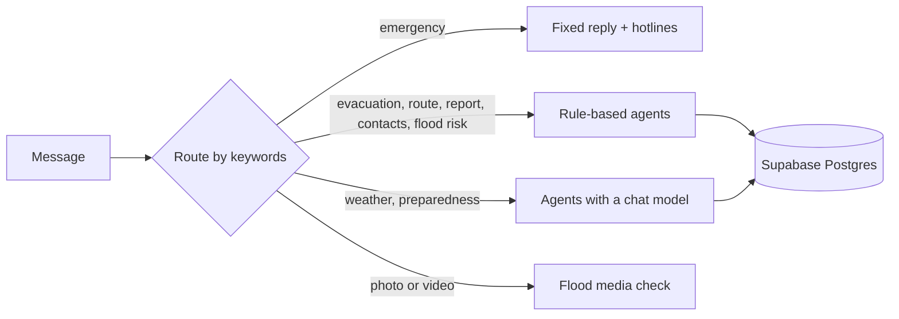

<p align="center">
  
</p>

<h1 align="center" id="title">
  
</h1>

A flood assistant for Metro Manila (NCR). Residents ask questions in English or Filipino and get answers
grounded in official sources: the nearest safe evacuation center, the flood risk for their area, a route that
avoids flooded streets, hotlines, and weather from PAGASA and Open-Meteo.

When the data is missing or unreliable, it says so and gives a fixed safety answer. It does not guess.

> **Status: early.** The agents, chat graph, retrieval, voice and flood-photo checks are built and tested.
> The FastAPI server (`backend/main.py` is a stub) and the Next.js frontend are not built yet.
> A Streamlit dashboard is included as a sample. See [docs/backend_architecture.md](docs/backend_architecture.md).

## What it can do

| Ask about | What answers | Needs a model? |
|---|---|---|
| Nearest evacuation center | Centers from the database, flooded areas removed, sorted by distance | No |
| "Will it flood?" | Rule-based level (low, watch, high, critical) from rain, river flow and PAGASA warnings | No |
| Route to a center | Route that avoids reported and known flooded areas | No |
| Hotlines | Numbers for the city, from a CSV | No |
| Report a flood | Saved as an unverified community report | No |
| Weather and forecasts | PAGASA bulletins plus Open-Meteo | Yes |
| Preparedness and policy | Retrieval over the documents in `corpus/` | Yes |
| Photo or video of a flood | Checks for flood water and estimates rough depth | Yes |
| Emergencies ("trapped", "waist-deep") | Fixed reply with 911 and local hotlines | No |

Most answers use fixed rules and no model, so they are fast, free per question, and the same every time.

## How an answer is chosen

Messages are routed by keywords (no model call), and an emergency always wins.



**Where the data comes from, in order of trust:**

1. PAGASA bulletin. It counts as unreliable when it is empty, very short, or a block page.
2. Backup sources, each read on its own: tide height, ground height, and the official sites (NDRRMC, Red Cross, DSWD).
3. A fixed safety answer, when too few readings are left to say anything responsible.

Locations are read from GPS coordinates, "Brgy. Name, City", or a place next to a city ("Gentry Manor, Parañaque").
If only the city is known, the answer says distances are from the city centre.

## Repository layout

```
backend/                 Python app (uv project)
  agents/                one module per agent: evacuation, flood risk, route, report, weather, location, ...
  langgraph_orchestrator/ chat graph, keyword routing, start-up
  src/rag/               document ingestion and retrieval (vector + keyword search, reranking)
  voice/  video/         speech-to-text WebSocket; flood photo and video checks
  tests/                 unit tests (no network, browser or model needed)
corpus/                  source documents and CSVs (evacuation centers, hotlines, locations)
datasets/                daily NCR weather and flood-feature CSVs
scripts/                 data loading and the daily dataset update
docs/                    architecture, evaluation and deployment notes
frontend/                Next.js app (not built yet)
frontend_streamlit/      sample Streamlit dashboard
.github/workflows/       scheduled dataset update
```

## Getting started

Requires Python 3.11+ and [uv](https://docs.astral.sh/uv/).

```bash
cd backend
uv sync                  # heavy: includes torch and faiss-gpu
```

Create `backend/.env` (it is gitignored; never commit it) with these variables:

| Variable | Used for |
|---|---|
| `MUSE_API` | The chat model, speech-to-text and the flood photo and video check |
| `SUPABASE_PROJECT_REF`, `SUPABASE_PASSWORD`, `SUPABASE_POOLER_HOST` | Database connection |
| `LANGSMITH_KEY`, `LANGSMITH_TRACE`, `LANGSMITH_PROJECT` | Optional tracing |
| `HF_TOKEN` | Embedding model download in `scripts/ingest_corpus.py` |

Other keys that appear in the docs ([deployment guide](docs/deployment_workflow_guide.md)) are only needed for features
that are not wired up yet: `SUPABASE_PUBLISHABLE_KEY`, `SUPABASE_SECRET_KEY`, `SUPABASE_ACCESS_TOKEN`,
`GROQ_API_KEY` and `LLAMAINDEX_API_KEY`.

### Run the tests

```bash
cd backend
uv run python -m unittest discover -s tests -v
```

### Try the dashboard

```bash
pip install -r frontend_streamlit/requirements.txt
streamlit run frontend_streamlit/app.py
```

### Ask the agent one question

There is no server yet. To try the chat graph, build it with `langgraph_orchestrator.graph.build_graph` and call
`ask_reply` (see the docstrings in `graph.py` and `service.py`). The database must be reachable.

## Data

Weather and flood-feature CSVs in `datasets/` are updated every day at 00:00 Philippine time by
[`update-datasets.yml`](.github/workflows/update-datasets.yml). It fetches the missing days from Open-Meteo,
appends new rows to Supabase (never updates or deletes), and commits the CSVs back. The workflow needs the repository
secrets `SUPABASE_PROJECT_REF`, `SUPABASE_PASSWORD` and `SUPABASE_POOLER_HOST`. Details: [docs/dataset_updates.md](docs/dataset_updates.md).

## Example questions

Each message works best with one request and a named place:

- `Nasa Divisoria, Manila ako. Baha hanggang tuhod. Saan ang pinakamalapit na evacuation center?`
- `Babaha ba sa Marikina ngayong gabi?`
- `Paano pumunta mula Brgy. Tambo, Parañaque papunta sa Baclaran Elementary School na iwas baha?`
- `Hotline ng Pasig?`

## Safety

If you or someone else is in danger, call **911** and contact your barangay or local DRRMO. Move to higher ground and
do not walk or drive through floodwater. Official sources: [pagasa.dost.gov.ph](https://pagasa.dost.gov.ph) and
[ndrrmc.gov.ph](https://ndrrmc.gov.ph).

## Documentation

- [Backend architecture](docs/backend_architecture.md)
- [Frontend architecture](docs/frontend_architecture.md)
- [Retrieval and ingestion](docs/ingestion_details.md)
- [Dataset updates](docs/dataset_updates.md)
- [Voice chat](docs/voice_chat.md)
- [Flood photo and video check](docs/flood_media.md)
- [Deployment workflow](docs/deployment_workflow_guide.md)
- [Evaluation rubric](docs/evaluation_rubric.md) and [agent benchmarks](docs/agent_benchmarks.md)

## Limitations

- **Coverage is Metro Manila only.** There is no flood data or evacuation list for areas outside NCR, such as Cavite.
- **No prediction of how long a flood will last.**
- **Distances are straight lines** and map positions are approximate. Always confirm with the barangay or local DRRMO.
- **Reports are unverified** community input. They never override PAGASA or NDRRMC information.
- **The risk level is a rule of thumb**, not an official warning. The thresholds should be tuned against past floods.
- **The `reports` table has no creation script yet.** `backend/sql/001_reports_geo.sql` only adds the `lat` and `lng` columns to a table that must already exist. Until it is created in Supabase, community reports cannot be saved or read.
- **One request per message works best.** A message that reports a flood and also asks for an evacuation center only gets the report handled.
- **Urgency is detected from phrases** ("hanggang tuhod", "waist-deep"), not understood. Wording the lists don't include, such as "up to waist" or "hanggang hita", is treated as a normal message.
- **A stale PAGASA bulletin still counts as reliable** if it is long and well formed. There is no check on its issue time yet.
- **Backup sources are limited.** MMDA gauges (blocked by a site challenge), Project NOAH (a JavaScript app with no searchable text) and GPM IMERG satellite rainfall (needs a NASA login) are not used.
- **Tide and ground-height rules are rules of thumb** (high tide at 1.2 m or more, low ground at 5 m or less) and are untuned. The tide model only covers the sea, so inland cities often have no tide data.
- **Only the city is recorded for a typed place.** A subdivision such as "Gentry Manor" is found on the map, but the barangay ("Tambo") is not saved with the location.
- **No server or app yet.** The agents can only be used from code.

## Future improvements

**Make it usable**
- Build the FastAPI server and routers (`/chat`, `/reports`, health) and the Next.js frontend.
- Create the `reports` table, and add a creation script next to `001_reports_geo.sql`.
- Add a small command-line script to ask the agent one question without writing code.
- Add CI: backend tests and lint, frontend build, secret scanning and dependency updates.
- Add an alert when the nightly dataset update fails, and a check that the newest CSV date is recent.

**Answer better**
- Handle a message with several requests: save the report, give safety steps, list centers, then answer the rest.
- Widen emergency and urgency detection ("up to waist", "hanggang hita"), possibly with a model as a second check and the keywords as a floor.
- Add the nearest centers to the emergency reply for people who also ask where to go.
- Answer "how long will it last?" with the next 24 hours of rain and tide, and say plainly that duration cannot be predicted.
- Keep the barangay with a place the user typed, using a list of Metro Manila barangays, and match place names against the evacuation-center table.
- Check the issue time of PAGASA bulletins and treat old ones as unreliable.

Tagalog questions it should answer better, to use as test cases for the items above:

| Question | What goes wrong now | Fix needed |
|---|---|---|
| `Nasa Divisoria, Manila ako. Gusto kong mag-report ng baha hanggang baywang. Saan ako pwedeng pumunta na evacuation center at gaano katagal ang baha?` | Gives the 911 and hotline reply (correct), but the report is not saved, no centers are listed, and duration is not answered | Several requests in one message; add the nearest centers to the emergency reply; duration answer |
| `Hanggang hita na ang baha. Saan ang pinakamalapit na evacuation center?` | "Hanggang hita" is not recognised as urgent, and with no place named it only asks "saang lungsod?": no 911, no safety steps | Wider emergency phrases; safety steps before any question |
| `Gaano katagal ang baha sa Marikina?` | Answers with the forecast risk ("LOW, walang senyales ng baha"), which does not answer the question and reads as reassurance to someone already flooded | Duration answer from rain and tide, with a clear limit |
| `Nasa Tanza, Cavite ako. May data ka ba ng baha?` | Asks "saang lungsod?" again instead of saying the area is not covered | Clear "outside coverage" reply |

English questions it should answer better, to use as test cases for the items above:

| Question | What goes wrong now | Fix needed |
|---|---|---|
| `I'm in Divisoria, Manila. I want to report a flood up to my waist. Where can I go to an evacuation center, and how long will it last?` | Only the report is handled; no safety steps, no centers, no answer about duration | Several requests in one message; wider emergency phrases; duration answer |
| `Water is up to my waist. Where is the nearest evacuation center?` | "Up to my waist" is not recognised as an emergency, and with no place named it only asks "which city?": no 911, no safety steps | Wider emergency phrases; safety steps before any question |
| `I'm in Tanza, Cavite. Do you have flood data?` | Asks "which city?" again instead of saying the area is not covered | Clear "outside coverage" reply |
| `How long will the flood last in Marikina?` | Answers with the forecast risk ("LOW, no flood signal"), which does not answer the question and reads as reassurance to someone already flooded | Duration answer from rain and tide, with a clear limit |
| `What is the process of relief goods?` | Describes what the government does, with citations that name no document | Sources list; steps a resident can take |

**Cover more**
- Extend the datasets, centers and city tables beyond NCR, starting with Cavite, Rizal and Bulacan. Until then, give a clear "outside coverage" reply with contacts instead of asking for the location again.
- Add flood event labels (MMDA gauges, NDRRMC reports, Project NOAH hazard maps), river and dam levels, terrain and drainage layers, and satellite rainfall for better risk rules.
- Tune the risk thresholds against past floods, and measure them with the evaluation rubric.

## License

MIT. See [LICENSE](LICENSE).


<footer align="center">
  <a href="frontend/public/thankyou_footer.jpg" target="_blank">
    
  </a>
</footer>