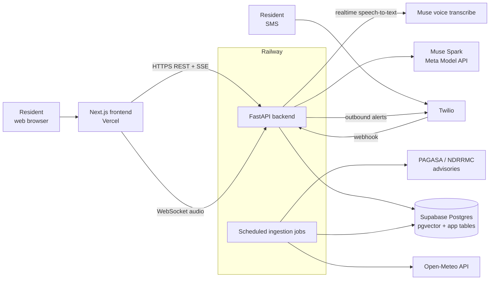
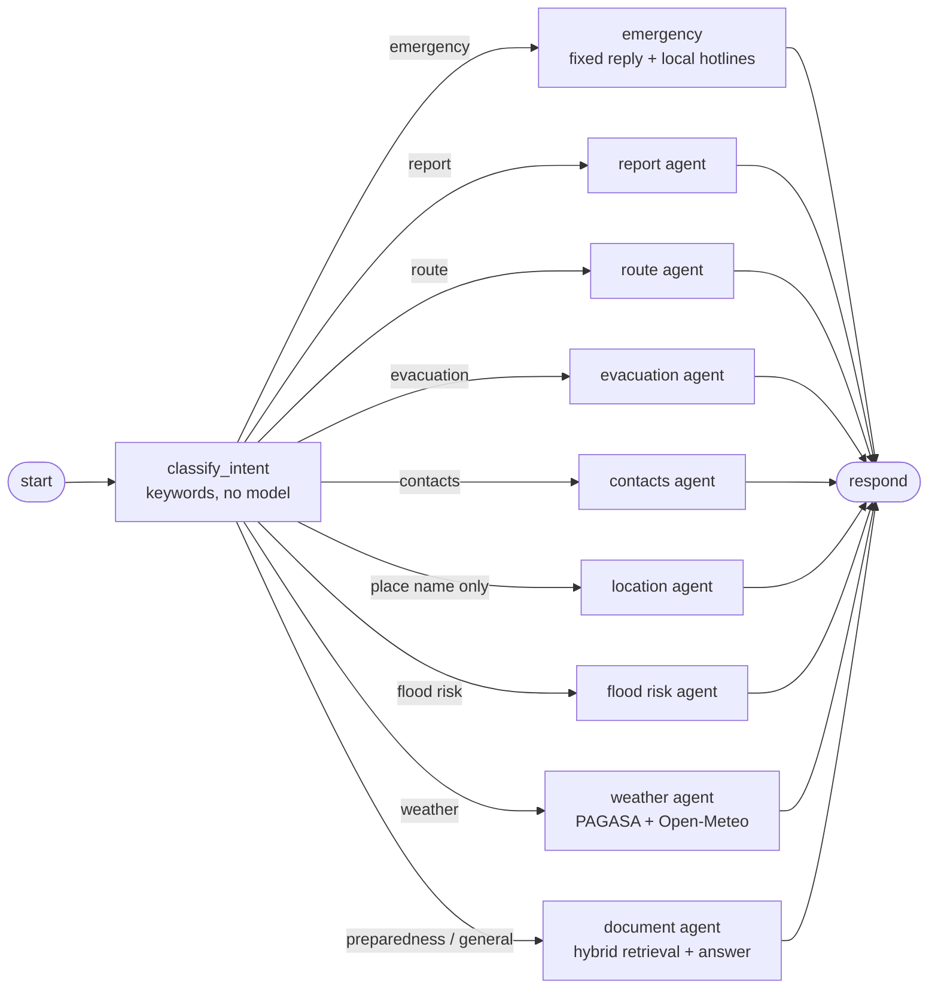
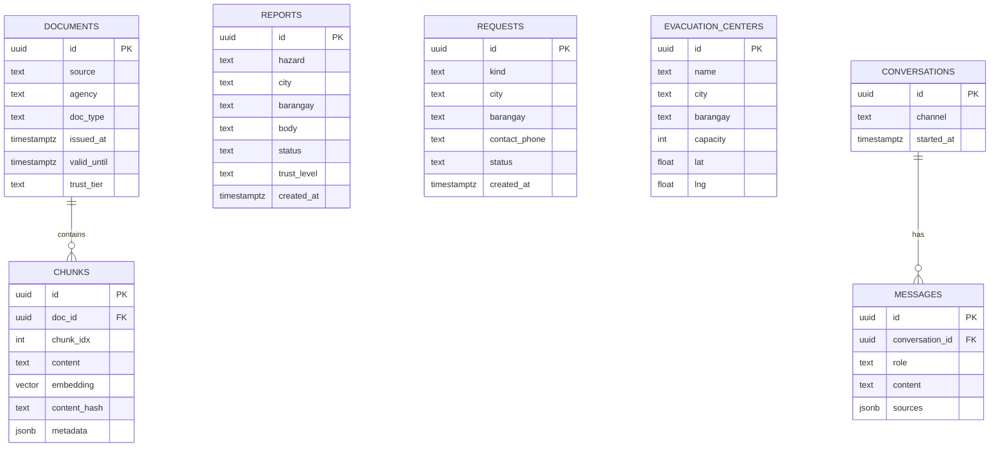
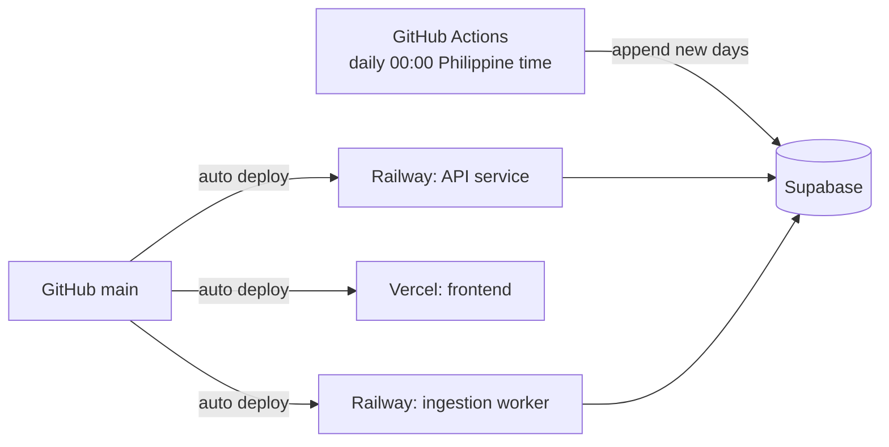

# Backend Architecture

Design for the Flood-Gentic backend (FastAPI + LangGraph on Railway, data in Supabase).
Status: **partly built**. Built: the flood agents, the LangGraph chat graph with a Postgres checkpointer, the RAG package
(chunking, embeddings, FAISS and pgvector stores, retrieval), the realtime voice WebSocket, and the dataset update scripts.
Not built yet: the FastAPI app itself (`main.py` is still a stub), the HTTP routers, the Twilio webhook and a scheduled
ingestion worker. Retrieval details live in `docs/ingestion_details.md`, voice in `docs/voice_chat.md`, the weather
datasets in `docs/dataset_updates.md`; this document covers everything around them.

## 1. Goals and constraints

- Answer disaster-preparedness questions for Metro Manila (NCR), grounded in verified sources.
- Accept community reports and supply requests, and notify people by SMS.
- Prefer "no verified information" over a guess on safety-critical questions.
- Stack is fixed: Python 3.11+, FastAPI, LangChain / LangGraph, Supabase Postgres (pgvector), Twilio, deployed on Railway.

## 2. System context



## 3. Layout

```
backend/
  main.py                 # stub: the FastAPI app and router registration are still to do
  agents/                 # one module per flood agent (section 5)
    contacts_agent.py       hotlines for a city, copied from the CSV (no model)
    document_agents.py      flood questions answered from stored documents (RAG)
    evacuation_agent.py     nearest evacuation centers that are not flooded
    flood_risk_agent.py     rule-based risk level from rain, river and PAGASA data
    location_agent.py       where the user is (coordinates, barangay, city)
    report_agent.py         community flood reports
    route_agent.py          route to a center that avoids flooded areas
    weather_agent.py        PAGASA + Open-Meteo answers
    fetch_supabase_open_meteo_datasets.py   live forecast + recent history from Supabase
    fetch_weather_using_browser.py          PAGASA pages
    flood_media_agent.py    checks a photo or video for flood water with SAM 3.1 (docs/flood_media.md)
    flood_zones.py, flood_types.py          shared helpers and types
  langgraph_orchestrator/ # graph.py (the chat graph), intents.py (keyword routing), service.py (start-up)
  checkpointer/           # Postgres checkpointer (saved conversations) and database settings
  voice/                  # asr_realtime.py, websocket_router.py (docs/voice_chat.md)
  video/                  # sam_client.py, flood_scene.py, camera_router.py, demo_app.py: SAM 3.1 flood detection (docs/flood_media.md)
  prompts/                # system prompts of the weather and document agents
  utils/                  # TTL cache, hourly model-call budget, distance and text helpers
  sql/                    # one-off schema changes (001_reports_geo.sql)
  src/
    rag/                  # ingestion + retrieval (see ingestion_details.md)
      loaders.py            fetch and clean source documents
      chunking.py           per-source-type chunking
      embeddings.py         embedding model
      faiss_store.py        local FAISS snapshots
      vector_store.py       pgvector read / write
      ingest.py             documents -> chunks -> Supabase
      bm25.py               in-memory keyword index
      fusion.py             Reciprocal Rank Fusion
      retriever.py          filter -> vector + BM25 -> fusion
      reranking.py          cross-encoder rerank
      rules.py              expiry, trust boost, diversity cap, score threshold
      models.py             Chunk and SearchFilter
    services/             # fetch_postgre_database.py, twilio_services.py (env loading only)
  tests/                  # agents, graph and voice WebSocket tests
scripts/                  # ingestion and dataset scripts (docs/dataset_updates.md)
```

Planned but not built: `src/api/` (routers: chat, reports, requests, alerts, health), `src/models/` (Pydantic schemas) and `src/config.py`.
Keep each module small and single-purpose; routers will contain no business logic.

## 4. API surface

| Method | Path | Purpose |
|---|---|---|
| POST | `/chat` | Ask a question; streams the answer (SSE) with citations |
| POST | `/reports` | Submit a community incident report |
| GET | `/reports` | List recent reports (filter by area, hazard, status) |
| POST | `/requests` | Submit a supply / assistance request |
| GET | `/evacuation-centers` | Search centers by city / barangay |
| GET | `/advisories/latest` | Current official advisories for an area |
| POST | `/webhooks/twilio` | Inbound SMS; validates Twilio signature |
| GET | `/health` | Liveness and dependency check |
| WS | `/ws/voice` | Live speech-to-text for the chat box. **Built**, see `docs/voice_chat.md` |
| WS | `/ws/camera` | Webcam flood check, one frame every few seconds. **Built**, see `docs/flood_media.md` |

Only `/ws/voice` and `/ws/camera` exist so far (`voice/websocket_router.py`, `video/camera_router.py`); the other endpoints are planned.

Request and response bodies are Pydantic models. Every chat response includes `sources`
(title, agency, issued time, link) so the UI can show provenance.

## 5. Chat flow (LangGraph)

Each message is routed by keywords (`langgraph_orchestrator/intents.py`), so routing costs nothing and is the same every time.
An emergency always wins; then the specific flood services; then preparedness, flood risk and weather. Anything
unrecognised goes to the document agent, which answers from stored material or says it has no information.



Only the weather and document agents call the chat model; the others use fixed rules or copy data exactly (a wrong
phone number or route can cost a life). An hourly cap on model calls (`utils/call_budget.py`) returns a busy reply when it is used up.

The graph remembers, per conversation (saved by the Postgres checkpointer under a `thread_id`): the user's `location`,
the last suggested `destination` (for "how do I get there?"), and a `pending_intent` when an agent asked "which city are you in?".
Emergency intent short-circuits everything else so urgent contacts are never delayed by search or model latency.

## 6. Data model (Supabase)



`chunks.embedding` uses an HNSW index. Row-level security stays on for all user-facing tables.

**What exists in Supabase today**

| Table | State |
|---|---|
| `chunks` | Created and filled (359 rows, 1024-dimension vectors, HNSW index). One table keyed by `(doc_id, chunk_idx)`; there is no separate `documents` table, so source, type, trust tier, hazard, city and validity live in the `metadata` column |
| `ncr_locations`, `ncr_weather_daily`, `ncr_flood_features_daily` | Created and filled by `scripts/load_to_supabase.py` and kept current by the daily workflow (`docs/dataset_updates.md`) |
| `reports`, `evacuation_centers` | Queried by the report, evacuation and route agents (`src/services/fetch_postgre_database.py`; `sql/001_reports_geo.sql` adds `lat` / `lng` to `reports`) but **not created yet** in this database |
| `requests`, `conversations`, `messages` | Not created. Conversation state is saved by the LangGraph checkpointer instead |

All the tables above have row-level security on with no policies: only the backend's direct Postgres connection can read or write them.

## 7. Ingestion jobs

Today these are run by hand from `scripts/`: `ingest_corpus.py` (chunk, embed, save a FAISS run and optionally write Supabase),
`refresh_location_chunks.py` (re-embed only the location chunks when `corpus/ncr_locations.csv` changes) and
`load_to_supabase.py` (one-time load of the datasets and a FAISS run). The daily weather datasets are updated by a GitHub
Actions workflow (`docs/dataset_updates.md`). Scheduled workers (separate Railway service or cron) for the full pipeline
(fetch, clean, chunk, enrich, embed, upsert, then rebuild the BM25 index) are still planned. Schedules and expiry rules are in
`docs/ingestion_details.md` section 5. Jobs are idempotent (upsert on `doc_id` + `chunk_idx`) and should log counts of fetched, new, skipped and failed items.

## 8. Cross-cutting concerns

- **Configuration**: all secrets from environment variables (`.env.example` lists names only). Never commit `.env`.
  Current variable names (values live only in `backend/.env`): `MUSE_API` (chat model and speech-to-text), `SUPABASE_PROJECT_REF`,
  `SUPABASE_PASSWORD`, `SUPABASE_POOLER_HOST` (or one `SUPABASE_DB_URL`), `SUPABASE_PUBLISHABLE_KEY`, `SUPABASE_SECRET_KEY`,
  `HF_TOKEN`, `LANGSMITH_KEY`, `GROQ_API_KEY`, `LLAMAINDEX_API_KEY`, and `TWILIO_ACCOUNT_SID`, `TWILIO_AUTH_TOKEN`, `TWILIO_PHONE_NUMBER`.
  Optional: `ORS_API_KEY` (routing), `EMBEDDING_MODEL`. The secret key bypasses row-level security, so it must never reach the browser.
- **Safety**: community reports are stored with a low trust level and never presented as official. Answers about evacuation or warnings must cite an official source or fall back to hotlines.
- **Security**: validate Twilio signatures on webhooks; rate-limit `/chat` and `/reports` per IP; strip PII (phone numbers) from logs; restrict CORS to the Vercel origin.
- **Observability**: structured JSON logs, LangSmith tracing for graph runs (already a dependency), request ids on every response.
- **Resilience**: timeouts and retries on LLM, Open-Meteo and Twilio calls; if the LLM is down, `/chat` returns the hotline fallback and top retrieved advisories rather than an error.
- **Testing**: `backend/tests/` holds 39 tests (flood agents, the graph with a fake model, the voice WebSocket with a fake transcriber). Still to add: chunkers, RRF and rules, and the evaluation set in `docs/evaluation_rubric.md` for retrieval and answer quality.

## 9. Deployment



The Railway and Vercel services are planned; the GitHub Actions dataset workflow is the only automation written so far.

Environment variables are set per service in Railway / Vercel. Details belong in `docs/deployment_workflow_guide.md`.

## 10. Open questions

- Which Muse Spark model and reasoning effort to use per agent (see `docs/agent_benchmarks.md`), and a model for query rewrite.
- Text-to-speech for spoken replies: Meta's voice docs reviewed so far only cover speech-to-text, and a Filipino voice is unchecked.
- Whether the BM25 index lives in the API process or the worker (affects replica count).
- Account model: anonymous chat only for the prototype, or phone-number login via Twilio?
- Which government advisories have usable machine-readable feeds versus scraping.
