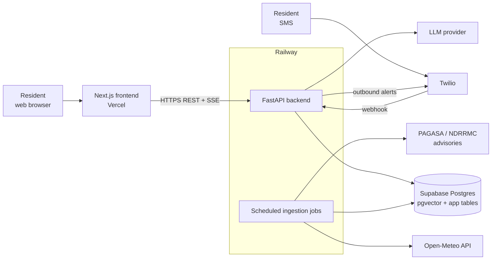
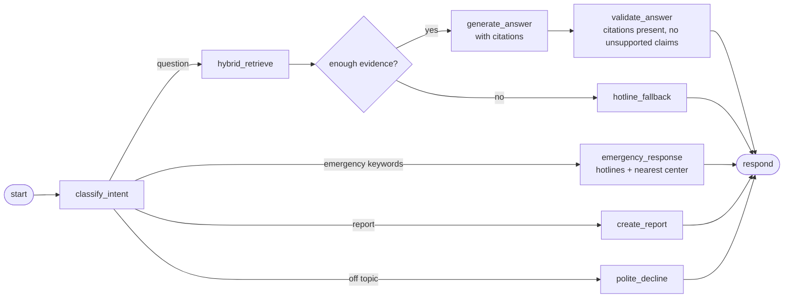
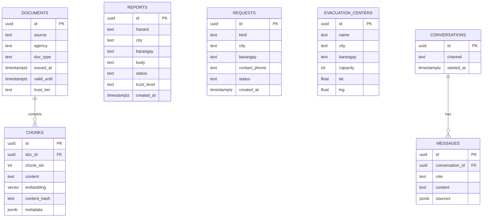
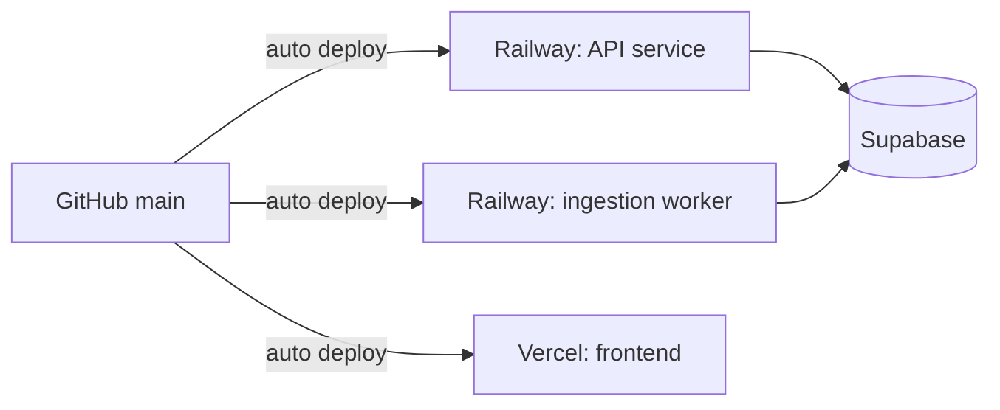

# Backend Architecture

Design for the Flood-Gentic backend (FastAPI + LangGraph on Railway, data in Supabase).
Status: **proposed**. Today `backend/` contains only a stub `main.py`, `src/services/twilio_services.py`
(env loading only) and an empty `src/services/fetch_postgre_database.py`. Retrieval details live in
`docs/ingestion_details.md`; this document covers everything around it.

## 1. Goals and constraints

- Answer disaster-preparedness questions for Metro Manila (NCR), grounded in verified sources.
- Accept community reports and supply requests, and notify people by SMS.
- Prefer "no verified information" over a guess on safety-critical questions.
- Stack is fixed: Python 3.11+, FastAPI, LangChain / LangGraph, Supabase Postgres (pgvector), Twilio, deployed on Railway.

## 2. System context



## 3. Proposed layout

```
backend/
  main.py                 # FastAPI app factory, router registration
  src/
    api/                  # routers: chat, reports, requests, alerts, health
    graph/                # LangGraph: state, nodes, edges
    rag/                  # ingestion + retrieval (see ingestion_details.md)
      loaders.py          #   fetch and clean source documents
      chunking.py         #   per-source-type chunking
      embeddings.py       #   embedding model
      vector_store.py     #   pgvector read / write
      bm25.py             #   in-memory keyword index
      fusion.py           #   Reciprocal Rank Fusion
      retriever.py        #   filter -> vector + BM25 -> fusion
      reranking.py        #   cross-encoder rerank
      rules.py            #   expiry, trust boost, diversity cap, score threshold
      models.py           #   Chunk and SearchFilter
    services/             # twilio_services.py, fetch_postgre_database.py, llm client
    models/               # pydantic request/response schemas
    config.py             # settings loaded from environment
```

Keep each module small and single-purpose; routers contain no business logic.

## 4. API surface

| Method | Path | Purpose |
|---|---|---|
| POST | `/chat` | Ask a question; streams the answer (SSE) with citations |
| POST | `/reports` | Submit a community incident report |
| GET | `/reports` | List recent reports (filter by area, hazard, status) |
| POST | `/requests` | Submit a supply / assistance request |
| GET | `/evacuation-centers` | Search centers by city / barangay |
| GET | `/advisories/latest` | Current official advisories for an area |
| POST | `/webhooks/twilio` | Inbound SMS; validates Twilio signature |
| GET | `/health` | Liveness and dependency check |

Request and response bodies are Pydantic models. Every chat response includes `sources`
(title, agency, issued time, link) so the UI can show provenance.

## 5. Chat flow (LangGraph)



Graph state: `messages`, `intent`, `location`, `language`, `retrieved_chunks`, `answer`, `sources`.
Emergency intent short-circuits retrieval so urgent contacts are never delayed by search or LLM latency.

## 6. Data model (Supabase)



`chunks.embedding` uses an HNSW index. Row-level security stays on for all user-facing tables.

## 7. Ingestion jobs

Scheduled workers (separate Railway service or cron) run fetch, clean, chunk, enrich, embed, upsert,
then rebuild the BM25 index. Schedules and expiry rules are in `docs/ingestion_details.md` section 5.
Jobs are idempotent (upsert on `doc_id` + `chunk_idx`) and log counts of fetched, new, skipped and failed items.

## 8. Cross-cutting concerns

- **Configuration**: all secrets from environment variables (`.env.example` lists names only). Never commit `.env`.
  Current variables: `TWILIO_ACCOUNT_SID`, `TWILIO_AUTH_TOKEN`, `TWILIO_PHONE_NUMBER`. Others to add: Supabase URL and key, LLM key, embedding model name.
- **Safety**: community reports are stored with a low trust level and never presented as official. Answers about evacuation or warnings must cite an official source or fall back to hotlines.
- **Security**: validate Twilio signatures on webhooks; rate-limit `/chat` and `/reports` per IP; strip PII (phone numbers) from logs; restrict CORS to the Vercel origin.
- **Observability**: structured JSON logs, LangSmith tracing for graph runs (already a dependency), request ids on every response.
- **Resilience**: timeouts and retries on LLM, Open-Meteo and Twilio calls; if the LLM is down, `/chat` returns the hotline fallback and top retrieved advisories rather than an error.
- **Testing**: unit tests for chunkers, RRF and rules; integration tests for the graph with a fake LLM; the evaluation set in `docs/evaluation_rubric.md` for retrieval and answer quality.

## 9. Deployment



Environment variables are set per service in Railway / Vercel. Details belong in `docs/deployment_workflow_guide.md`.

## 10. Open questions

- LLM provider and model for answers vs. query rewrite.
- Whether the BM25 index lives in the API process or the worker (affects replica count).
- Account model: anonymous chat only for the prototype, or phone-number login via Twilio?
- Which government advisories have usable machine-readable feeds versus scraping.
