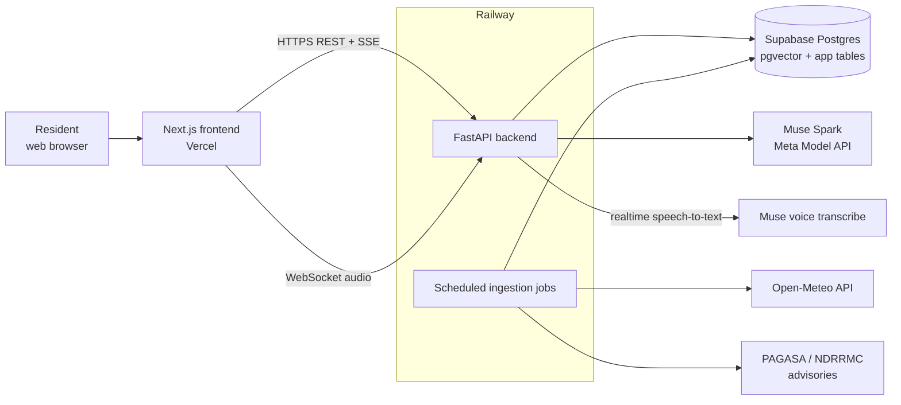
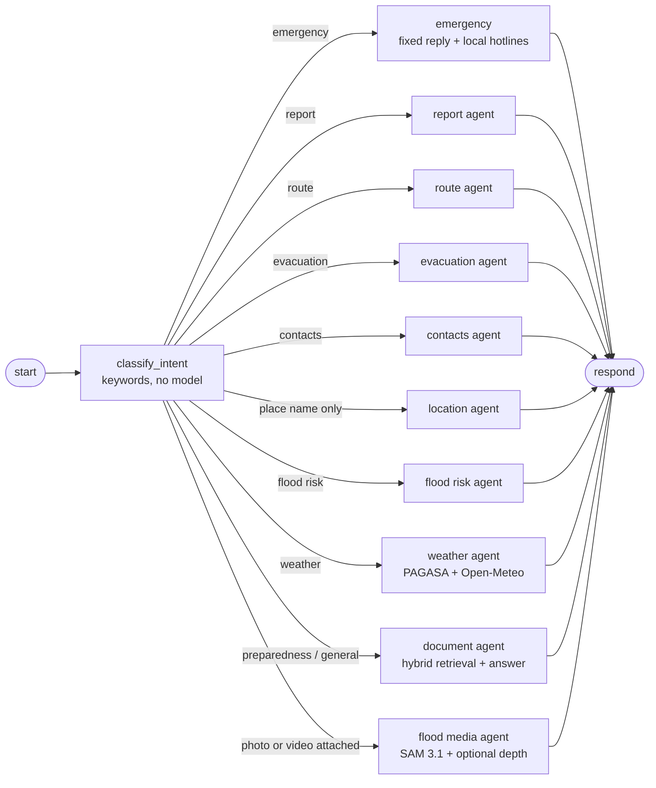
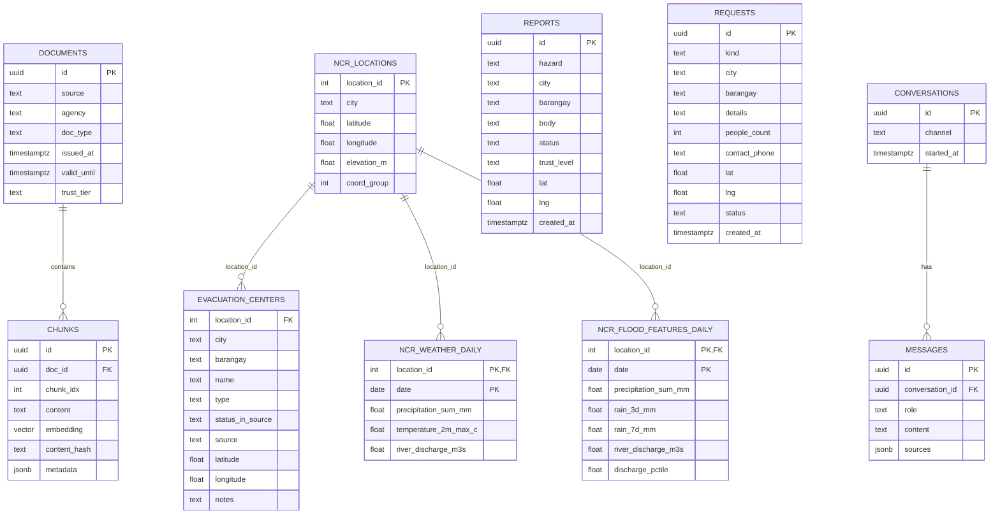
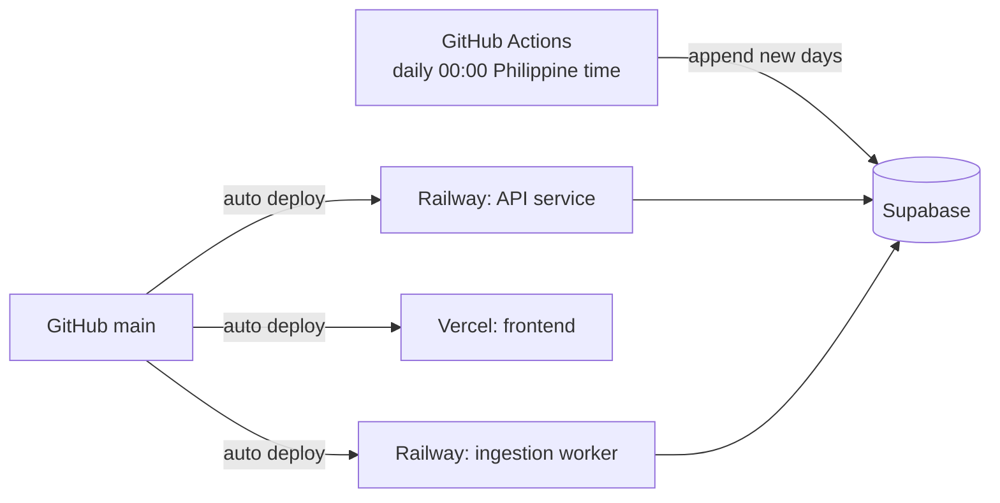

# Backend Architecture

Design for the Flood-Gentic backend (FastAPI + LangGraph on Railway, data in Supabase).
Status: **partly built**. Built: the flood agents, the LangGraph chat graph with a Postgres checkpointer, the RAG package
(chunking, embeddings, FAISS and pgvector stores, retrieval), the FastAPI app and its routers (`src/api/`), the realtime voice WebSocket,
the staff endpoints for reviewing reports and requests, and the dataset update scripts. Not built yet: streaming and a source list on `/chat`,
media upload, per-person staff accounts, and a scheduled ingestion worker. Retrieval details live in `docs/ingestion_details.md`, voice in `docs/voice_chat.md`, the weather
datasets in `docs/dataset_updates.md`; this document covers everything around them.

## 1. Goals and constraints

- Answer disaster-preparedness questions for Metro Manila (NCR), grounded in verified sources.
- Accept community reports and supply requests.
- Prefer "no verified information" over a guess on safety-critical questions.
- Stack is fixed: Python 3.11+, FastAPI, LangChain / LangGraph, Supabase Postgres (pgvector), deployed on Railway.

## 2. System context



## 3. Layout

```
backend/
  main.py                 # entry point: `uvicorn main:app` (the app is built in src/api/app.py)
  agents/                 # one module per flood agent (section 5)
    contacts_agent.py       hotlines for a city, copied from the CSV (no model)
    coverage_agent.py       "not covered" reply and national hotlines for a place outside Metro Manila (no model)
    flood_duration_agent.py "how long will the flood last?": 24-hour rain and tide outlook, no predicted duration (no model)
    document_agents.py      flood questions answered from stored documents (RAG)
    evacuation_agent.py     nearest evacuation centers that are not flooded
    flood_risk_agent.py     rule-based risk level from rain, river and PAGASA data
    location_agent.py       where the user is (coordinates, barangay, city)
    report_agent.py         community flood reports
    route_agent.py          route to a center that avoids flooded areas
    weather_agent.py        PAGASA + Open-Meteo answers
    fetch_supabase_open_meteo_datasets.py   live forecast + recent history from Supabase
    fetch_weather_using_browser.py          PAGASA pages
    flood_media_agent.py    checks a photo or video for flood water with SAM 3.1 (docs/flood_media.md)
    flood_zones.py, flood_types.py          shared helpers and types
  langgraph_orchestrator/ # graph.py (the chat graph), intents.py (keyword routing), service.py (start-up)
  checkpointer/           # Postgres checkpointer (saved conversations) and database settings
  voice/                  # asr_realtime.py, websocket_router.py (docs/voice_chat.md)
  video/                  # sam_client.py, flood_scene.py, camera_router.py, demo_app.py, depth_model.py, flood_depth.py: SAM 3.1 flood detection and rough depth (docs/flood_media.md)
  prompts/                # system prompts of the weather and document agents
  utils/                  # TTL cache, hourly model-call budget, distance and text helpers, LangSmith tracing (tracing.py)
  sql/                    # one-off schema changes (001_reports_geo.sql)
  src/
    rag/                  # ingestion + retrieval (see ingestion_details.md)
      loaders.py            fetch and clean source documents
      chunking.py           per-source-type chunking
      embeddings.py         embedding model
      faiss_store.py        local FAISS snapshots
      vector_store.py       pgvector read / write
      ingest.py             documents -> chunks -> Supabase
      bm25.py               in-memory keyword index
      fusion.py             Reciprocal Rank Fusion
      retriever.py          filter -> vector + BM25 -> fusion
      reranking.py          cross-encoder rerank
      rules.py              expiry, trust boost, diversity cap, score threshold
      models.py             Chunk and SearchFilter
    api/                  # the HTTP API (section 4)
      app.py                create_app(): CORS, rate limits, error format, routers
      startup.py            opens the database, chat model, document search and chat graph
      settings.py           environment settings (CORS_ORIGINS, CHECKPOINTER, rate limits, ...)
      schemas.py            request and response models (Pydantic)
      deps.py               shared dependencies, rate-limit check and error texts
      rate_limit.py         in-memory sliding-window limiter
      routers/              chat, reports, help_requests, evacuation, advisories, health, staff
    services/             # fetch_postgre_database.py, shared_connection.py
  tests/                  # agents, graph, voice and camera WebSockets, tracing helpers (conftest.py keeps tests out of LangSmith)
scripts/                  # ingestion and dataset scripts (docs/dataset_updates.md)
```

Keep each module small and single-purpose; routers contain no business logic. Request validation lives in `src/api/schemas.py`.

## 4. API surface

| Method | Path | Purpose | State |
|---|---|---|---|
| POST | `/chat` | Ask a question; returns the reply, a `thread_id` and the `safe_answer` flag | **Built** (JSON; no streaming or source list yet) |
| POST | `/reports` | Submit a community incident report | **Built** (needs the `reports` table) |
| GET | `/reports` | List recent reports (filter by city, hazard); rejected ones and phone-like digits are hidden | **Built** (needs the `reports` table) |
| POST | `/requests` | Submit a supply / assistance request. Write only: it can hold a phone number | **Built** (needs the `requests` table) |
| GET | `/evacuation-centers` | Search centers by city / barangay | **Built** |
| GET | `/advisories/latest` | Current PAGASA bulletins; says plainly when they cannot be read | **Built** (national pages; `city` only marks which mention it) |
| GET | `/staff/summary` | Counts of reports and requests by status and city, and how long the oldest unreviewed one has waited | **Built** (staff key) |
| GET | `/staff/reports`, `/staff/requests` | The newest items in full (unredacted text, exact position, contact phone); filter by status, city, hazard or kind | **Built** (staff key) |
| PATCH | `/staff/reports/{id}`, `/staff/requests/{id}` | Review: reports become verified or rejected; requests become verified, assigned or closed | **Built** (staff key) |
| GET | `/health`, `/health/ready` | Dependency check; `/health/ready` is 503 unless the database and chat graph work | **Built** |
| WS | `/ws/voice` | Live speech-to-text for the chat box, see `docs/voice_chat.md` | **Built** |
| WS | `/ws/camera` | Webcam flood check, one frame every few seconds, see `docs/flood_media.md` | **Built** |

How the API behaves:

- **Coverage:** every position must lie inside Metro Manila. A GPS point outside it is a 422 that says so and gives 911; it is not matched to the nearest city.
- **Errors:** a person in a flood can see them, so each one that is not a plain validation error says what to do next (911, barangay, DRRMO).
  Validation errors list where the problem is and what it is, but never repeat the value that was sent.
- **Limits:** `/chat`, `/reports` and `/requests` are limited per client address (`CHAT_PER_MINUTE`, `REPORTS_PER_HOUR`, `REQUESTS_PER_HOUR`).
  The limiter lives in one process; use a shared limit if the API runs on several replicas.
- **Conversations:** `thread_id` must be a UUID. Without one, `/chat` starts a new conversation and returns the id to send back.
- **Soft failures:** without `MUSE_API` the weather and document answers fail but everything that needs no model keeps working;
  if document search cannot start, the document agent gives the fixed safe answer.
- **Staff access:** the `/staff` endpoints exist only when `STAFF_API_KEY` is set (at least 24 characters). Every call must send
  `Authorization: Bearer <key>`; a missing or wrong key gets the same 401. They share a rate limit (`STAFF_PER_MINUTE`) that applies before the key is checked,
  which slows guessing. There is one shared key and no accounts, so a status change records what changed but not who changed it.
- **Review rules:** a rejected report is hidden from `GET /reports`, from routing and from the evacuation filter. A report or request stays
  `unverified` until a person changes it; nothing changes status on its own.
- **Settings:** `CORS_ORIGINS`, `CHECKPOINTER` (`postgres` or `memory`), `ENABLE_RAG`, `TRUST_PROXY_HEADERS`, `STAFF_API_KEY`, `STAFF_PER_MINUTE`, `ORS_API_KEY`; see `src/api/settings.py`.

Run it with `uv run uvicorn main:app --reload` and open `/docs` for the interactive documentation.

Request and response bodies are Pydantic models. Every chat response includes `sources`
(title, agency, issued time, link) so the UI can show provenance.

## 5. Chat flow (LangGraph)

Each message is routed by keywords (`langgraph_orchestrator/intents.py`), so routing costs nothing and is the same every time.
An emergency always wins; then a message with a photo or video attached goes to the media check; then the specific flood
services; then preparedness, flood risk and weather. Anything unrecognised goes to the document agent, which answers from stored
material or says it has no information.



Only the weather and document agents call the chat model (the media agent calls SAM 3.1, and optionally a depth model, instead); the others use fixed rules or copy data exactly (a wrong
phone number or route can cost a life). An hourly cap on model calls (`utils/call_budget.py`) returns a busy reply when it is used up.

The graph remembers, per conversation (saved by the Postgres checkpointer under a `thread_id`): the user's `location`,
the last suggested `destination` (for "how do I get there?"), and a `pending_intent` when an agent asked "which city are you in?". A `media`
reference (kind plus an https `url` or a `path` inside `MEDIA_UPLOAD_DIR`, and an optional `estimate_depth`) is kept for one message only and cleared by
every node, so a file is checked once and the saved conversation never holds the file itself.
Emergency intent short-circuits everything else so urgent contacts are never delayed by search or model latency.

## 6. Data model (Supabase)



The diagram shows the columns that exist (or, for `reports` and `requests`, that the scripts in `backend/sql/` create). `DOCUMENTS`,
`CONVERSATIONS` and `MESSAGES` are design only: see the table below. The weather and flood-feature tables are shortened to a few columns.

**Joining by `location_id`.** `location_id` is the key that ties the location data together. `ncr_locations` holds one row per Metro Manila
city (17 rows, with its elevation), and `evacuation_centers`, `ncr_weather_daily` and `ncr_flood_features_daily` all carry the same
`location_id`. A center can therefore be joined to its city's elevation, recent rain and river flow without matching city names, which are spelled
differently in the tables ("Parañaque City" in the centers, "Parañaque" in the locations):

```sql
SELECT e.name, e.barangay, l.elevation_m, f.rain_3d_mm, f.discharge_pctile
FROM evacuation_centers e
JOIN ncr_locations l USING (location_id)
LEFT JOIN ncr_flood_features_daily f
       ON f.location_id = e.location_id AND f.date = (SELECT max(date) FROM ncr_flood_features_daily)
WHERE e.location_id = 4;
```

All 102 centers match one of the 17 locations. The weather and flood-feature tables enforce the link with a foreign key; `evacuation_centers`
does not yet, so a typo there would not be caught by the database. A center is identified by `(city, barangay, name)`, which is unique; there is no
separate `id` column and no `capacity` column.

`reports` and `requests` hold the city as a text key (`"paranaque"`, `"quezon city"`), as the agents use it, not as a `location_id`. Adding a
`location_id` to both would let them join the same way.

`chunks.embedding` uses an HNSW index. Row-level security stays on for all user-facing tables.

**What exists in Supabase today**

| Table | State |
|---|---|
| `chunks` | Created and filled (461 rows, 1024-dimension vectors, HNSW index). One table keyed by `(doc_id, chunk_idx)`; there is no separate `documents` table, so source, type, trust tier, hazard, city and validity live in the `metadata` column |
| `ncr_locations`, `ncr_weather_daily`, `ncr_flood_features_daily` | Created and filled by `scripts/load_to_supabase.py` and kept current by the daily workflow (`docs/dataset_updates.md`) |
| `evacuation_centers` | Created and filled (102 rows, 17 cities); joins to `ncr_locations` on `location_id`; read by the evacuation and route agents and by `GET /evacuation-centers` |
| `reports` | **Does not exist yet.** Queried by the report agent, the route agent and `/reports`. Create it with `sql/000_reports.sql`, then `sql/001_reports_geo.sql` |
| `requests` | **Does not exist yet.** Written by `POST /requests`. Create it with `sql/002_requests.sql` |
| `conversations`, `messages` | Not created. Conversation state is saved by the LangGraph checkpointer instead |

All the tables above have row-level security on with no policies: only the backend's direct Postgres connection can read or write them.

## 7. Ingestion jobs

Today these are run by hand from `scripts/`: `ingest_corpus.py` (chunk, embed, save a FAISS run and optionally write Supabase),
`refresh_location_chunks.py` (re-embed only the location chunks when `corpus/ncr_locations.csv` changes) and
`load_to_supabase.py` (one-time load of the datasets and a FAISS run). The daily weather datasets are updated by a GitHub
Actions workflow (`docs/dataset_updates.md`). Scheduled workers (separate Railway service or cron) for the full pipeline
(fetch, clean, chunk, enrich, embed, upsert, then rebuild the BM25 index) are still planned. Schedules and expiry rules are in
`docs/ingestion_details.md` section 5. Jobs are idempotent (upsert on `doc_id` + `chunk_idx`) and should log counts of fetched, new, skipped and failed items.

## 8. Cross-cutting concerns

- **Configuration**: all secrets from environment variables (`.env.example` lists names only). Never commit `.env`.
  Current variable names (values live only in `backend/.env`): `MUSE_API` (chat model and speech-to-text), `SUPABASE_PROJECT_REF`,
  `SUPABASE_PASSWORD`, `SUPABASE_POOLER_HOST` (or one `SUPABASE_DB_URL`), `SUPABASE_PUBLISHABLE_KEY`, `SUPABASE_SECRET_KEY`,
  `HF_TOKEN`, `LANGSMITH_KEY`, `LANGSMITH_TRACE`, `LANGSMITH_PROJECT`, `GROQ_API_KEY`, and `LLAMAINDEX_API_KEY`.
  Optional: `ORS_API_KEY` (routing), `EMBEDDING_MODEL`. The secret key bypasses row-level security, so it must never reach the browser.
- **Safety**: community reports are stored with a low trust level and never presented as official. Answers about evacuation or warnings must cite an official source or fall back to hotlines.
- **Security**: rate-limit `/chat` and `/reports` per IP; strip PII (phone numbers) from logs; restrict CORS to the Vercel origin.
- **Observability**: LangSmith tracing is on when `LANGSMITH_TRACE=true` and `LANGSMITH_KEY` are set in `backend/.env` (project `flood-gentic`).
  Each chat message is one run named `flood-gentic-chat`, tagged `flood-gentic` and carrying the `thread_id`, with the graph nodes, the agents
  (`utils/tracing.py`, `@traced_agent`) and the model calls nested inside. Every run is cleaned before it is sent: phone-number-like digits
  are replaced, secrets are hidden and coordinates are rounded to about 1 km. Details in `docs/deployment_workflow_guide.md`.
  Still to add: structured JSON logs and request ids on every response.
- **Resilience**: timeouts and retries on LLM and Open-Meteo calls; if the LLM is down, `/chat` returns the hotline fallback and top retrieved advisories rather than an error.
- **Testing**: `backend/tests/` holds 39 tests (flood agents, the graph with a fake model, the voice WebSocket with a fake transcriber). Still to add: chunkers, RRF and rules, and the evaluation set in `docs/evaluation_rubric.md` for retrieval and answer quality.

## 9. Deployment



The Railway and Vercel services are planned; the GitHub Actions dataset workflow is the only automation written so far.

Environment variables are set per service in Railway / Vercel. Details belong in `docs/deployment_workflow_guide.md`.

## 10. Open questions

- Which Muse Spark model and reasoning effort to use per agent (see `docs/agent_benchmarks.md`), and a model for query rewrite.
- Text-to-speech for spoken replies: Meta's voice docs reviewed so far only cover speech-to-text, and a Filipino voice is unchecked.
- Whether the BM25 index lives in the API process or the worker (affects replica count).
- Account model: anonymous chat only for the prototype.
- Which government advisories have usable machine-readable feeds versus scraping.
