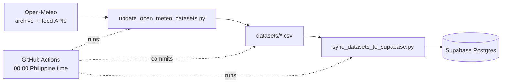

# Dataset Updates

How the daily weather files in `datasets/` and the matching Supabase tables are kept current.
What the data contains is described in `notebooks/datasets_exploration/open-meteo-manual_data_exploration.ipynb`;
the corpus (PDFs and chunks) is covered in `docs/ingestion_details.md`.

## 1. Overview



Both steps only **add** data. Rows that already exist are skipped and never changed.

| Script | Does | Writes to |
|---|---|---|
| `scripts/update_open_meteo_datasets.py` | Fetches the missing days from Open-Meteo | the two daily CSV files |
| `scripts/sync_datasets_to_supabase.py` | Adds the rows Supabase does not have yet | Supabase tables |
| `scripts/load_to_supabase.py` | One-time full load: empties and reloads the dataset tables, upserts the FAISS chunks | Supabase tables |
| `scripts/refresh_location_chunks.py` | Re-embeds only the `ncr-locations-*` chunks after `corpus/ncr_locations.csv` changed; writes a new FAISS run | Supabase `chunks`, `faiss_vectors/` |

Run the scripts from `backend/` so the installed packages are found, for example
`uv run python ../scripts/update_open_meteo_datasets.py`.

## 2. Files and tables

| CSV in `datasets/` | Supabase table | Key | Content |
|---|---|---|---|
| `ncr_locations.csv` | `ncr_locations` | `location_id` | One point per NCR city (17): city-centre coordinates, elevation, city |
| `ncr_weather_daily_2020-2026.csv` | `ncr_weather_daily` | `(location_id, date)` | Daily rain, temperature, wind, radiation, river discharge |
| `ncr_flood_features_daily.csv` | `ncr_flood_features_daily` | `(location_id, date)` | The same days plus rolling rain, wet streak and discharge features |

Both daily files are sorted by `location_id`, then `date`. Row-level security is on for every table with no policies,
so only the backend's direct Postgres connection can read or write them.

## 3. Fetching new days

`update_open_meteo_datasets.py` works in this order:

1. Reads the points from `ncr_locations.csv`. Locations that share coordinates are requested once (today each of the 17 cities has its own coordinate).
2. Finds the first missing day: the day after the oldest "last day" among the locations.
3. Requests only that range, cut into windows of 14 days. The end date is today minus 2 days by default, because the newest days are still being finalised. Days that come back without rain data are dropped.
4. Calculates the derived columns, then inserts the new rows into each file at the right place. Old lines keep their exact text; running it twice in a row does nothing.
5. Writes nothing unless every request succeeded.

Options: `--dry-run` shows the plan and makes no requests, `--end-date YYYY-MM-DD` sets the last day, `--max-calls N` sets the call cap (default 500).

### Rebuilding from scratch

`--rebuild` ignores what is in the two files, fetches every day from 2020-01-01 and replaces both files. Use it after
`ncr_locations.csv` changed. It uses 90-day windows for weather and 365-day windows for discharge, waits 2 s between calls and
saves each finished coordinate in a cache folder (the system temp directory, or `--cache-dir`), so a run stopped by a limit
or a network error continues from the cache when started again. Network timeouts are retried up to 5 times with a growing wait.
Afterwards run `scripts/load_to_supabase.py` to replace the Supabase tables (it empties and reloads them).

### Sources

| Data | API | Variables |
|---|---|---|
| Daily weather | `archive-api.open-meteo.com/v1/archive` (timezone `Asia/Manila`) | `precipitation_sum`, `temperature_2m_max/min`, `shortwave_radiation_sum`, `wind_speed_10m_max`, `wind_gusts_10m_max` |
| Hourly values | same call | `temperature_2m`, `precipitation` |
| River discharge | `flood-api.open-meteo.com/v1/flood` | `river_discharge` |

### Derived columns

These rules were worked out from the existing data and checked against it.

| Column | Rule |
|---|---|
| `temperature_2m_max/min_from_hourly_c` | Hottest and coolest hour of the day |
| `rain_max_1h_mm` | Heaviest single hour |
| `rain_max_3h_mm`, `rain_max_6h_mm` | Heaviest rolling 3 or 6 hour total **inside the day** (does not cross midnight) |
| `rain_3d_mm`, `rain_7d_mm`, `rain_14d_mm` | Trailing sum of daily rain, counting the days that exist so far |
| `wet_streak_days` | Consecutive days (including today) with at least 1.0 mm of rain |
| `discharge_change_1d_pct` | Change from yesterday in percent; empty when yesterday was 0 |
| `discharge_max_3d_m3s` | Highest discharge in the last 3 days |
| `discharge_pctile` | Rank of the day within the location's whole history, 0 to 1 |
| `elevation_m` | Copied from `ncr_locations.csv` |

Rolling values need earlier days, so they are calculated on the old and new rows together and only the new rows are kept.

## 4. Open-Meteo request limits

The free plan allows 600 calls a minute, 5,000 an hour and 10,000 a day. A call over many days or variables counts as several.
The script stays well inside that:

- At least 0.5 s between calls (at most 120 a minute).
- Windows of at most 14 days.
- A normal daily update is 14 calls (7 coordinates, weather and discharge each).
- A per-minute `429` waits 61 s and retries; an hourly or daily `429` stops the run with nothing written.
- `--max-calls` stops a run that would need more calls than planned. A backfill of about a year needs roughly 360 calls.

## 5. Appending to Supabase

`sync_datasets_to_supabase.py` copies each CSV into a temporary staging table, then runs
`INSERT ... ON CONFLICT DO NOTHING` on the real table. Existing rows are never updated or deleted.
It creates the three tables first if they are missing. Output looks like:

```
ncr_locations: 0 new rows added
ncr_weather_daily: 51 new rows added
ncr_flood_features_daily: 51 new rows added
```

The connection comes from `SUPABASE_DB_URL`, or from `SUPABASE_PROJECT_REF` + `SUPABASE_PASSWORD` + `SUPABASE_POOLER_HOST`
(the transaction pooler, port 6543). See `backend/.env.example`.

## 6. Scheduled workflow

`.github/workflows/update-datasets.yml` runs every day at 00:00 Philippine time. The cron is `0 16 * * *` because
GitHub uses UTC and the Philippines (UTC+8) has no daylight saving. GitHub can start scheduled runs a few minutes late.
It can also be started by hand with **Run workflow** (`workflow_dispatch`).

Steps: install `pandas`, `httpx`, `psycopg[binary]` and `python-dotenv`; fetch new days; append to Supabase; commit the changed CSV files.
Runs never overlap (`concurrency`) and are cut off after 30 minutes.

### Setup

Add these repository secrets (Settings, Secrets and variables, Actions):

| Secret | Value |
|---|---|
| `SUPABASE_PROJECT_REF` | the id in `https://<ref>.supabase.co` |
| `SUPABASE_PASSWORD` | the database password |
| `SUPABASE_POOLER_HOST` | `aws-0-eu-west-1.pooler.supabase.com` |

The workflow file must be on the repository's default branch for the schedule to run.

### Commit-back step

The last step commits the two daily CSVs and pushes them with the built-in `GITHUB_TOKEN` (`contents: write`).
Without it the runner would start from the repository's old copy and request a longer gap every day, until the call cap is hit.
If branch protection blocks the push, either allow the Actions bot to bypass it or remove that step and run the fetch locally.
If the sync fails, nothing is committed, so the next run fetches the same days again.

## 7. Reading the data in the weather agent

`backend/agents/fetch_supabase_open_meteo_datasets.py` combines the live forecast with the stored history.
For the city in the user's question it returns:

| Key | Content |
|---|---|
| `plan` | the detected city, topics and forecast days |
| `weather` | the live Open-Meteo forecast (current, hourly, daily) |
| `history` | the last 7 days from `ncr_flood_features_daily`, one row per day, oldest first |

Each history row has `date`, `rain_mm`, `rain_max_1h_mm`, `rain_3d_mm`, `rain_7d_mm`, `rain_14d_mm`, `wet_streak_days` and `river_discharge_m3s`.
A city can have several sample points, so rain is averaged and discharge and wet streak take the highest point.
The result is cached for 30 minutes because the tables change once a day.

`history` is `[]` when the dataset has no point in that city (it covers all 17 NCR cities; a note such as
"Pateros (municipality)" is ignored when matching) and `None` when Supabase cannot be read. Either way the forecast is still returned, and
`weather_agent.py` only adds the "Recent days" lines to the prompt when there are rows. Pass `include_history=False` to skip the read.

## 8. Known limitations

- **Nearby cities can share weather.** Open-Meteo weather comes on a grid of about 0.1 degrees, so close points (for example
  Las Piñas and Parañaque) get identical rain, wind and temperature. River discharge comes from a finer grid and usually differs.
- **If `ncr_locations.csv` changes, rebuild.** `location_id` is the key in both daily files and in Supabase, so changing which city
  an id means (or moving a point) makes the stored rows wrong. Run `update_open_meteo_datasets.py --rebuild`, then
  `scripts/load_to_supabase.py`. The rebuild is about 600 calls and 20 to 30 minutes; if a limit stops it, run the same command again.
  The 2026-10 rebuild replaced the earlier 7-coordinate data.
- **`discharge_pctile` of old rows is never refreshed.** New rows are ranked against the whole history, but earlier rows keep their old rank.
- **Append only.** If Open-Meteo later revises a day that was already stored, the stored value is not corrected.
- **Gaps inside the range are not filled.** Only days after the last stored day are requested.
- **Flood API dates are in UTC** (its default), while the archive API uses `Asia/Manila`.
