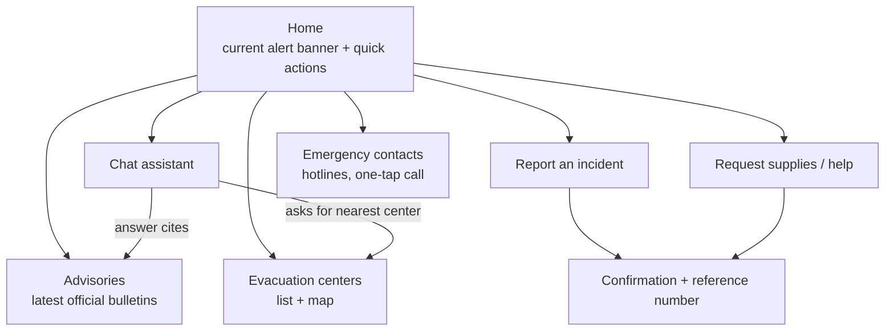
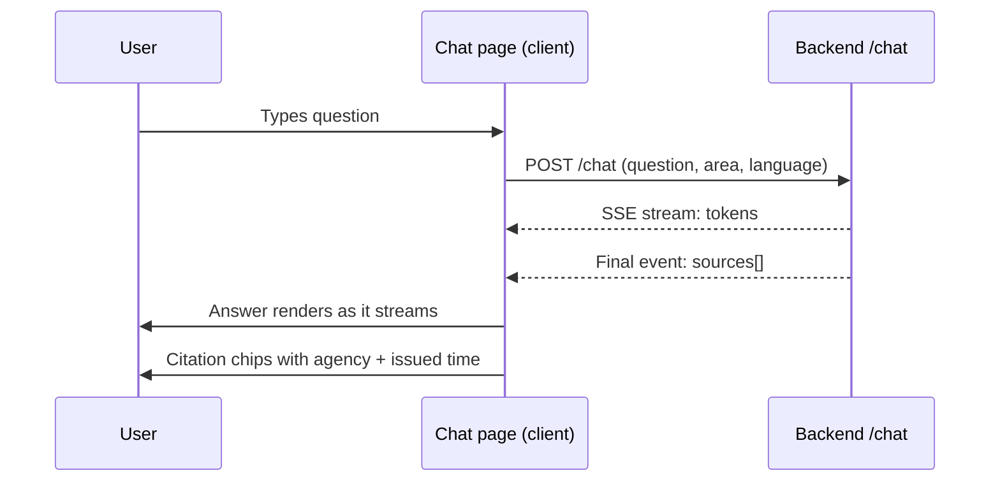

# Frontend Architecture

Design for the CAI-Lamity web app (Next.js on Vercel).
Status: **proposed**. Today `frontend/` has Next 16 / React 19 in `package.json`, a `public/page.tsx`
and an empty `components/ui` folder. The app is not scaffolded yet, so this document also fixes the target structure.

## 1. Goals

- Usable on a low-end phone over a weak connection: the audience includes people with limited access to reliable information.
- Emergency information reachable in one tap, before any chat is needed.
- Bilingual (English / Filipino) from the start.
- Always show where an answer came from and how fresh it is.

## 2. Screens



| Route | Purpose |
|---|---|
| `/` | Alert banner for the selected area, quick actions, link to chat |
| `/chat` | Conversation with streamed answers and citations |
| `/evacuation-centers` | Searchable list and map, filter by city / barangay |
| `/advisories` | Latest official advisories with issue time and expiry |
| `/report` | Incident report form |
| `/request` | Supply / assistance request form |
| `/emergency` | Hotlines, works fully offline once loaded |

## 3. Proposed structure

```
frontend/
  app/                    # App Router: layout.tsx, page.tsx, route folders above
  components/
    ui/                   # buttons, inputs, cards, banner (existing folder)
    chat/                 # message list, input, citation chip
    maps/                 # evacuation map wrapper
    forms/                # report and request forms
  lib/
    api.ts                # typed client for the backend
    i18n.ts               # English / Filipino strings
    location.ts           # selected city / barangay, geolocation helper
  public/                 # static assets, manifest, icons
```

The stray `public/page.tsx` should move into `app/` once the app is scaffolded.

## 4. Data flow



- Server components fetch advisories and evacuation centers (cacheable, short revalidate window).
- Client components handle chat streaming, forms and geolocation.
- The API base URL comes from `NEXT_PUBLIC_API_URL` (see `frontend/.env.example`); no secrets in the browser.

## 5. Key components

| Component | Responsibility |
|---|---|
| `AlertBanner` | Shows the highest-severity active advisory for the chosen area; links to details |
| `ChatWindow` | Streams messages, shows typing state, error and retry |
| `CitationChip` | Agency, title, issued time; marks expired or community-sourced content differently |
| `AreaPicker` | City / barangay selector, remembered locally |
| `ReportForm`, `RequestForm` | Validated forms, work with poor connectivity (retry, local draft) |
| `EmergencyCard` | Large tap-to-call hotline buttons |

## 6. UX and accessibility rules

- Mobile first; minimum 16 px body text, tap targets at least 44 px, high contrast in light and dark.
- Plain language, short sentences, no jargon in warnings; severity shown with text and icon, never color alone.
- Language toggle visible on every page; chat replies in the language the user wrote in.
- Official vs. community content is visually distinct everywhere it appears.
- Keyboard navigable, semantic HTML, screen-reader labels on icon buttons.

## 7. Resilience and performance

- Installable PWA: cache the shell, `/emergency` and the last-fetched evacuation centers and advisories for offline use.
- Show "last updated" times; mark cached data clearly as possibly out of date.
- Keep the initial bundle small: lazy-load the map and chat code; no heavy UI libraries.
- Graceful failure: if `/chat` fails, show hotlines and latest advisories instead of an empty error.

## 8. Deployment and configuration

- Vercel, deploys from `main`; preview deployments per pull request.
- `NEXT_PUBLIC_API_URL` points at the Railway backend; the backend CORS list must include the Vercel domains.
- Only `NEXT_PUBLIC_*` variables are exposed to the browser.

## 9. Open questions

- Map provider (OpenStreetMap-based tiles vs. a commercial SDK) and its offline story.
- Styling approach (Tailwind CSS is assumed; `components/ui` is currently empty).
- Whether SMS-only users need a web fallback link in outbound messages.
- Push notifications for new advisories: needed for the prototype or later?
