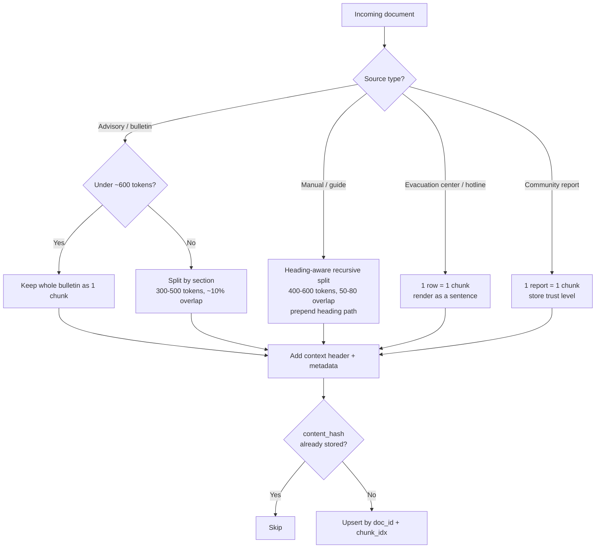
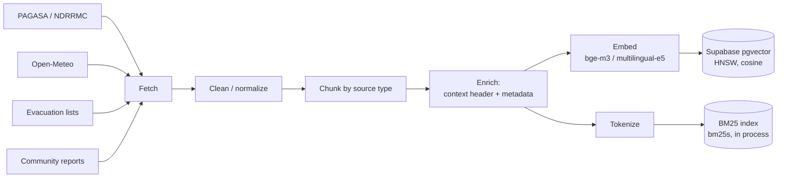
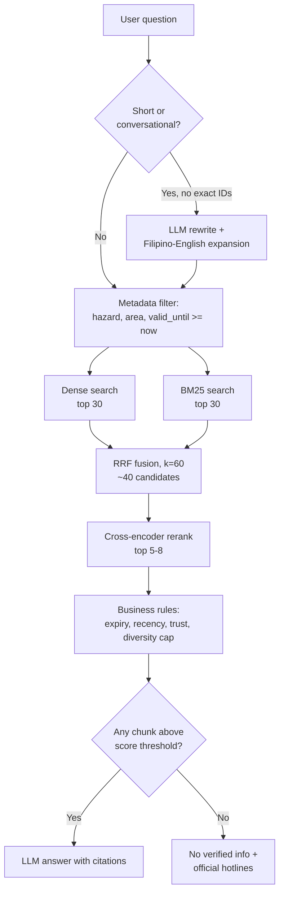
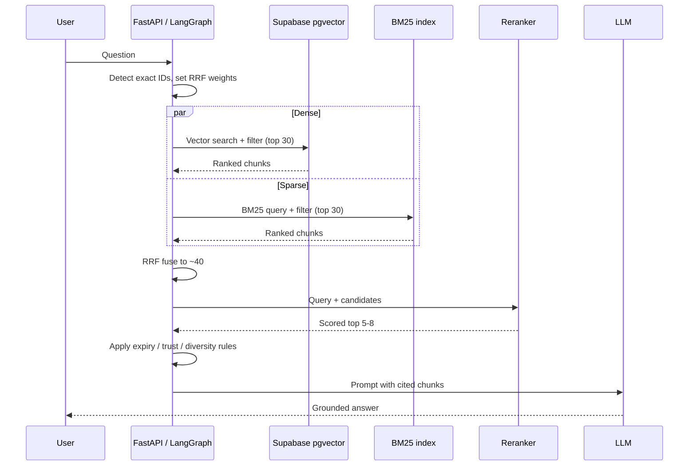
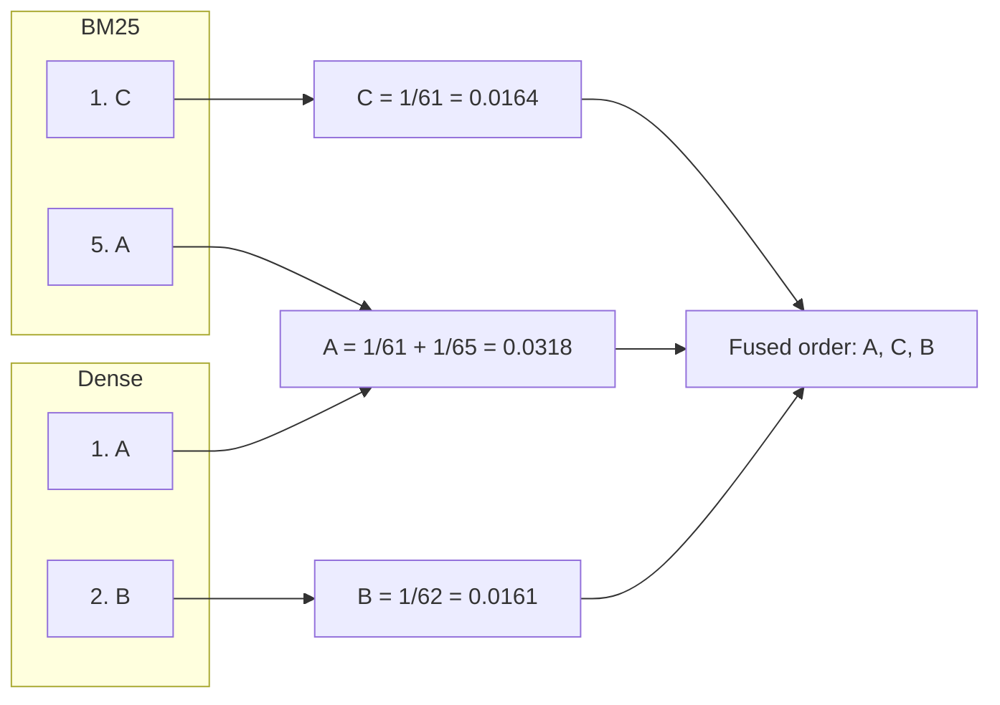
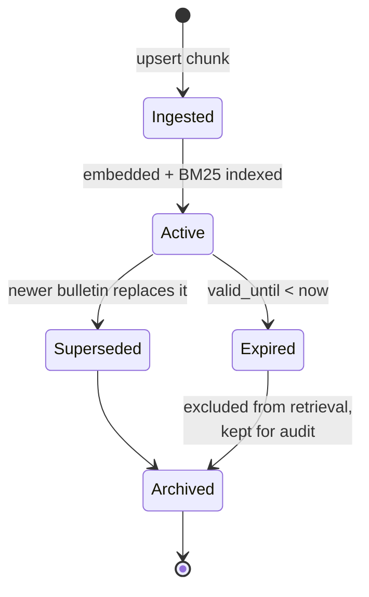
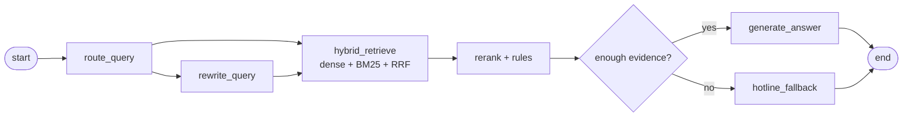
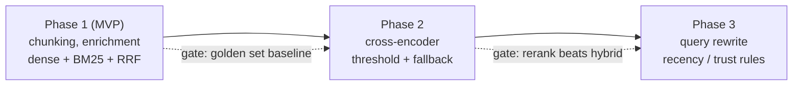

# Ingestion and Retrieval Details

How CAI-Lamity chunks, indexes, retrieves, and reranks disaster information.
Every number in this document (chunk sizes, `k` values, thresholds) is a **starting value**
to be tuned against the evaluation golden set described in section 8.

## 1. Corpus and why it shapes the design

| Source type | Examples | Traits |
|---|---|---|
| Official advisories | PAGASA bulletins, NDRRMC situation reports | Short, time-sensitive, expire quickly |
| Structured lists | Evacuation centers, hotlines | Row-like records, exact names and numbers |
| Long guides | NDRRMC / OCD preparedness manuals | Long, hierarchical, rarely change |
| Community reports | Resident incident and supply-request reports | Noisy, unverified, short |
| Weather data | Open-Meteo forecasts | Structured, refreshed often |

Queries mix English and Filipino and often contain exact tokens: typhoon names ("Carina"),
city and barangay names, "Signal No. 3", phone numbers. Dense embeddings handle paraphrase and
language mixing well but are weak on exact tokens. BM25 is the opposite. That is why retrieval
is hybrid. Freshness also matters: an expired advisory is worse than no advisory.

## 2. Chunking (per source type)

One splitter for everything would cut bulletins mid-warning and split evacuation records in
half, so the strategy depends on the source.

| Source type | Strategy | Size / overlap |
|---|---|---|
| Advisories, bulletins | Structure-aware split on headings and sections. Keep whole if under ~600 tokens. | 300-500 tokens, ~10% overlap |
| Manuals, guides | Heading-aware recursive split (Markdown or PDF section hierarchy). Prepend the heading path to each chunk. | 400-600 tokens, 50-80 overlap |
| Evacuation centers, hotlines | No splitting. One record per row, rendered as a sentence: "Center X, Barangay Y, City Z, capacity N." | One record = one chunk |
| Community reports | One chunk per report. Trust level kept in metadata. | One report = one chunk |

### Chunking decision flow



### Contextual enrichment

Prepend a one-line header to every chunk before embedding **and** before BM25 indexing:

```
[PAGASA | Tropical Cyclone Bulletin | 2026-10-24 | Metro Manila | typhoon] <chunk text>
```

This keeps a chunk like "Signal No. 3 is raised over..." understandable on its own and gives
BM25 the agency, hazard, and area terms to match.

### Metadata stored per chunk

`doc_id`, `chunk_idx`, `source`, `agency`, `doc_type`, `hazard`, `city`, `barangay`,
`issued_at`, `valid_until`, `language`, `trust_tier`, `content_hash`.

### Idempotent re-ingestion

Dedupe on `content_hash`. Upserts are keyed on `doc_id` + `chunk_idx`, so re-running an
ingestion job never duplicates chunks.

## 3. Hybrid retrieval

### Indexing path (offline)



### Query path (online)



### Request sequence



### Dense retriever
- Multilingual embedding model: `bge-m3` or `multilingual-e5` (Tagalog support is required).
- Stored in Supabase pgvector with an HNSW index, cosine distance.

### Sparse retriever (BM25)
- Real BM25, not Postgres `ts_rank`, which has no inverse-document-frequency saturation.
- Supabase does not offer `pg_search`, and the corpus is small (thousands of chunks), so
  recommend `bm25s` (or `rank_bm25`) built in process and rebuilt after each ingestion run.
- Tokenizer must work for English and Filipino: lowercase, no stemming that mangles Tagalog
  affixes, and keep numbers, phone numbers, and proper nouns as single tokens.
- Upgrade path if the corpus grows past roughly 1M chunks or several backend replicas need a
  shared index: ParadeDB (`pg_search`) or OpenSearch.

### Metadata pre-filter
Apply the same filter to both retrievers: hazard type, city/area, and `valid_until >= now`.
Filtering before ranking keeps expired or out-of-area chunks out of the candidate set.

### Fusion: Reciprocal Rank Fusion
- `score(d) = sum over retrievers of weight / (60 + rank(d))`
- Worked example (weights 1.0 / 1.0): chunk A is rank 1 in dense and rank 5 in BM25, chunk B is
  rank 2 in dense only.



  A chunk found by both retrievers beats chunks found by only one, without comparing raw scores.
- Take top 30 from each retriever, fuse to about 40 candidates.
- RRF uses ranks only, so no score normalization between BM25 and cosine is needed.
- Default weights 1.0 / 1.0. Raise the BM25 weight when the query contains an exact identifier
  (typhoon name, signal number, phone number, place name).

### Optional query step
LLM query rewrite and Filipino-to-English expansion, only when the query is conversational or
very short. Skip it for queries that already contain exact identifiers.

## 4. Reranking

Candidate funnel: each stage narrows the set and costs more per chunk than the one before.

```mermaid
flowchart TD
    A["Whole corpus<br/>thousands of chunks"] -->|metadata filter| B["Filtered pool"]
    B -->|dense top 30 + BM25 top 30| C["~40 fused candidates<br/>(cheap: vector + keyword)"]
    C -->|cross-encoder<br/>(expensive: reads query + chunk)| D["Top 5-8"]
    D -->|expiry, trust, diversity, threshold| E["Final context for LLM"]
```

1. **Cross-encoder rerank** of the ~40 fused candidates down to the top 5-8.
   - First choice: `bge-reranker-v2-m3` (multilingual, self-hosted, no per-call cost).
   - Hosted alternative: Cohere Rerank 3.5 multilingual, if CPU latency on Railway is a problem.
2. **Business rules after reranking**
   - Drop expired advisories; boost recent ones.
   - Boost official `trust_tier` sources over community reports.
   - Drop anything below a minimum rerank score.
3. **Diversity**: cap at 2-3 chunks per `doc_id` (or use MMR) so one bulletin cannot fill the context.
4. **Safety fallback**: if nothing clears the threshold, the assistant says it has no verified
   information and points to official hotlines. It must not improvise safety guidance.
5. **Prompt assembly**: each chunk is passed with its source and issued time so the answer can cite them.

## 5. Freshness and scheduling

| Data | Refresh | Expiry |
|---|---|---|
| Open-Meteo forecasts | Every 15-60 min | Short `valid_until` |
| Advisories / bulletins | Every 15-60 min | `valid_until` from the bulletin, else issue time + 24 h |
| Community reports | On submit | Review window, then downgrade |
| Manuals, evacuation lists | On change | None (re-ingest on update) |

Expired chunks are soft-deleted (filtered by `valid_until`) rather than physically removed, so
past answers stay auditable.



## 6. LangChain / LangGraph mapping

Code lives in `backend/src/rag/`: `loaders.py` -> `chunking.py` -> `embeddings.py` -> `vector_store.py` (write path);
`retriever.py` (`HybridRetriever`: `vector_store` + `bm25.py` + `fusion.py`) -> `reranking.py` -> `rules.py` (read path).

- Retrieval is a graph node: filter -> dense + BM25 -> RRF -> rerank -> rules.



- Fusion: `EnsembleRetriever` (RRF built in) or a small custom RRF function if per-query weights are needed.
- Reranking: `ContextualCompressionRetriever` wrapping the cross-encoder.
- Already in `backend/pyproject.toml`: `langchain`, `langchain-community`, `langgraph`.
- New dependencies: `bm25s`, `sentence-transformers` (or `FlagEmbedding`), `pgvector`.

## 7. Phased rollout

| Phase | Scope |
|---|---|
| 1 (MVP) | Per-source chunking, enrichment, dense + BM25, RRF |
| 2 | Cross-encoder reranker, score threshold, safety fallback |
| 3 | Query rewrite, recency / trust rules, diversity cap |



## 8. Evaluation

Tie into `docs/evaluation_rubric.md`.

- Build a golden set of about 50 bilingual (English / Filipino) NCR queries with labeled relevant chunks.
- Metrics: recall@k, MRR, nDCG@5, and answer groundedness (does the answer cite retrieved text).
- Ablation to justify each stage: dense only, BM25 only, hybrid, hybrid + rerank.
- Tune chunk sizes, `k`, RRF weights, and the rerank threshold on this set.

## 9. Open risks

- **Filipino tokenization**: no mature BM25 tokenizer; validate against the golden set.
- **Reranker latency**: roughly 200-500 ms for 40 candidates on CPU. Mitigate by trimming to 20-30
  candidates or using a hosted reranker.
- **In-process BM25 index**: rebuilt on ingest and duplicated per replica. Fine for MVP; revisit with ParadeDB / OpenSearch if it grows.
- **Community report quality**: unverified content must never outrank official sources on safety-critical questions.
