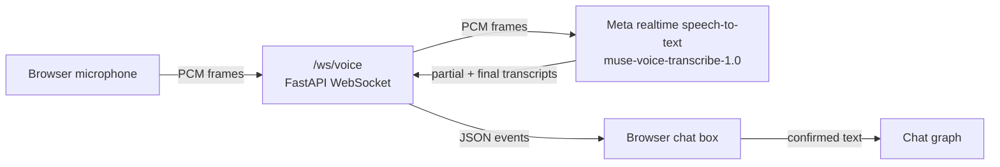

# Voice Chat

How spoken questions reach the chatbot. Status: **speech-to-text backend built, frontend and text-to-speech not built**.
The chat flow itself is in `docs/backend_architecture.md` section 5; this document covers only the voice path.

## 1. Flow

The browser talks only to the Flood-Gentic backend, never to Meta, so the `MUSE_API` key stays on the server.
The transcript is shown to the user before it is sent as a normal chat message, so the chat graph does not change.

## 2. WebSocket protocol

Connect to `/ws/voice?mode=endpointing&rate=24000`.

| Query parameter | Values | Meaning |
|---|---|---|
| `mode` | `endpointing` (default), `push_to_talk` | `endpointing` is hands-free: the server splits speech into turns, so one connection can hold several questions. `push_to_talk` gives one transcript; send `{"type": "end"}` when the button is released |
| `rate` | `24000` (default), `16000` | Sample rate of the audio the browser sends |

Browser to server:

| Message | Content |
|---|---|
| binary frame | Raw 16-bit little-endian mono PCM at `rate`, about 80 ms per frame, sent in real time |
| `{"type": "end"}` | No more audio. The server finishes and closes the socket |

Server to browser (JSON):

| Message | Meaning |
|---|---|
| `{"type": "ready", "sessionId": ...}` | The speech-to-text session is open; start sending audio |
| `{"type": "partial", "text": ...}` | Text so far. Each partial replaces the previous one |
| `{"type": "final", "text": ..., "turnId": ...}` | One finished question |
| `{"type": "error", "message": ...}` | Something failed (key missing, Meta unavailable, time limit). The socket then closes |

A bad `mode` or `rate` closes the socket with code 1008. One connection is cut off after 120 seconds (`MAX_SESSION_SECONDS`) to cap cost.

## 3. Code

| File | Role |
|---|---|
| `backend/voice/asr_realtime.py` | `RealtimeTranscriber`: opens Meta's realtime socket, sends the handshake and audio, ends the stream, yields events. `to_client_event()` turns Meta events into the messages above |
| `backend/voice/websocket_router.py` | `create_voice_router()`: the `/ws/voice` endpoint that relays audio and events. Add it with `app.include_router(create_voice_router())` |
| `backend/tests/test_voice_websocket.py` | Tests with a fake transcriber (no network) |

Recognition hints sent to Meta: language bias Tagalog and English, and keywords for the NCR city names, PAGASA and NDRRMC.

## 4. Meta speech-to-text API (reviewed 2026-10-29)

- Realtime: `wss://api.meta.ai/v1/asr/realtime`. The first message is a JSON handshake containing `Bearer <key>`, the model, `audioEncoding` (`PCM_16KHZ` or `PCM_24KHZ`), `mode` and optional `languageBias` / `keywords`. Audio goes as binary frames; `{"type": "endStream"}` ends the whole session and the server closes with code 1000.
- File upload (not used yet): `POST https://api.meta.ai/v1/asr/transcribe`, multipart with a JSON `request` part and a WAV `audio` part. WAV must be mono 16-bit PCM at 16 or 24 kHz, up to 10 minutes and 32 MB.
- 25 languages with code-switching; Tagalog is the only Filipino-related entry, so mixed Filipino-English accuracy on place names must be tested.
- Price: $0.18 per hour of audio. Limits per tenant: 256 concurrent streams and 16,000 streams per hour; a stream that falls more than 5 seconds behind real time is rejected.
- Only silence has been sent in tests so far. The handshake, audio, end of stream and clean close work with the project key; real speech has not been measured.

## 5. Safety rules for voice

Wrong flood guidance can cause harm, and speech recognition makes mistakes, so:

- Show the transcript and let the user fix or confirm it before it is sent.
- If a place name is uncertain, ask which city before answering.
- Emergency words ("saklolo", "trapped", "rescue") still route straight to the fixed emergency reply with hotlines.
- Everything available by voice must also work by typing.

## 6. Not built yet

- The FastAPI app that mounts the router (`main.py` is a stub).
- The browser side: microphone capture, resampling to 16-bit PCM (an AudioWorklet), the push-to-talk button and transcript display (`docs/frontend_architecture.md`).
- Spoken replies. Meta's docs reviewed so far only describe speech-to-text; a Filipino voice is unchecked, and the browser's built-in voice is the fallback.
- An origin check and per-IP rate limit on the socket (planned for `/chat` too).
- A phone line through Twilio Voice for people without data.
- Accuracy tests on recorded English, Tagalog and mixed questions (`docs/evaluation_rubric.md`).
